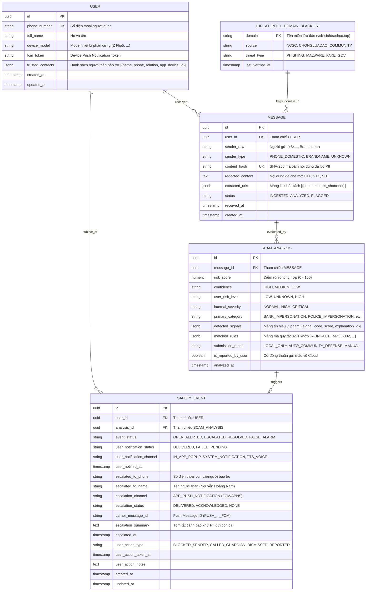

# Scam Message Detection — ERD & Data Model Specification
## Architecture Specification — Phiên bản 3.0 (Document-Relational Hybrid Schema)

> **Thông tin tài liệu:**  
> - **Phiên bản:** v3.0 (Document-Relational Hybrid — 4 Thực Thể Cốt Lõi)  
> - **Cập nhật:** Tháng 10/2026 — Senior Data Architect & Security Solution Architect  
> - **Tiêu chuẩn:** PostgreSQL 16+ với Native JSONB & Envelope Encryption  
> - **Tài liệu liên quan:**  
>   - [PRD: Đặc tả Yêu cầu Sản phẩm](file:///d:/Me%20mine/PM/UXCamp/Scam%20alert/scam_alert_check_link_4/docs/PRD.md)  
>   - [Báo cáo Kiểm thử & Hiệu chuẩn](file:///d:/Me%20mine/PM/UXCamp/Scam%20alert/scam_alert_check_link_4/docs/Test_Report.md)  
>   - [Sổ tay Giải thích Kiến trúc Rule Engine AST](file:///d:/Me%20mine/PM/UXCamp/Scam%20alert/scam_alert_check_link_4/docs/Rule_Engine_Architecture_Guide.md)  

---

## 1. Tổng Quan Kiến Trúc Dữ Liệu Tinh Gọn

Nhằm giải quyết triệt để vấn đề cổ chai hiệu năng (< 5ms độ trễ) và loại bỏ hoàn toàn các câu lệnh JOIN phức tạp từ 23 bảng quan hệ lý thuyết cũ, hệ thống đã chuẩn hóa toàn diện sang **Mô hình Lai Văn Bản - Quan Hệ (Document-Relational Hybrid Schema)** gồm **4 thực thể giao dịch cốt lõi**:

1. **`user`**: Quản lý danh tính người dùng, thiết bị phần cứng, token thông báo và mảng thông tin người thân bảo trợ (`trusted_contacts JSONB`).
2. **`message`**: Bản ghi tin nhắn đã khử sạch thông tin định danh (PII-redacted), mã băm chống trùng lặp (`content_hash`) và mảng đường link bóc tách (`extracted_urls JSONB`). Máy chủ tuân thủ nguyên tắc Zero Raw Storage: tuyệt đối không lưu nội dung thô.
3. **`scam_analysis`**: Bản ghi phân tích rủi ro bất biến (Append-only Audit Log), nhúng nguyên khối mảng tín hiệu vi phạm (`detected_signals JSONB`) và mảng quy tắc vi phạm (`matched_rules JSONB`).
4. **`safety_event`**: **Trung tâm Điều phối Sự cố Thống nhất (Unified Incident Hub)** quản trị trọn vẹn vòng đời sự cố, lịch sử gửi cảnh báo nạn nhân (`user_notification_*`), phát lệnh khẩn cấp tới con cái (`escalated_to_*`) và phản ứng xử lý (`user_action_*`).

Kèm theo là bảng dùng chung **`threat_intel_domain_blacklist`** phục vụ bộ nhớ đệm đồng bộ tự động từ Cục An toàn Thông tin (NCSC) và Chống Lừa Đảo.

---

## 2. Sơ Đồ Thực Thể Quan Hệ (Mermaid ERD)



---

## 3. Chi Tiết Data Dictionary (Từ Điển Dữ Liệu 4 Bảng)

### 3.1 Bảng `user`
| Cột | Kiểu dữ liệu | Ràng buộc | Ý nghĩa nghiệp vụ |
|---|---|---|---|
| `id` | `UUID` | PK, DEFAULT `gen_random_uuid()` | Định danh duy nhất người dùng |
| `phone_number` | `VARCHAR(20)` | UNIQUE, NOT NULL | Số điện thoại đăng ký bảo vệ |
| `full_name` | `VARCHAR(100)` | NULLABLE | Tên người dùng (Người cao tuổi) |
| `device_model` | `VARCHAR(50)` | NULLABLE | Dòng máy (Samsung Galaxy Z Flip5, etc.) |
| `fcm_token` | `TEXT` | NULLABLE | Token Push Notification của thiết bị |
| `trusted_contacts` | `JSONB` | DEFAULT `'[]'` | Danh bạ người thân nhận push: `[{"name": "...", "phone": "...", "relation": "Con trai"}]` |
| `created_at` | `TIMESTAMPTZ` | DEFAULT `NOW()` | Thời điểm tạo tài khoản |
| `updated_at` | `TIMESTAMPTZ` | DEFAULT `NOW()` | Thời điểm cập nhật cuối |

### 3.2 Bảng `message`
| Cột | Kiểu dữ liệu | Ràng buộc | Ý nghĩa nghiệp vụ |
|---|---|---|---|
| `id` | `UUID` | PK, DEFAULT `gen_random_uuid()` | Mã định danh duy nhất tin nhắn |
| `user_id` | `UUID` | FK `user.id`, NOT NULL | Người nhận tin nhắn |
| `sender_raw` | `VARCHAR(50)` | NOT NULL | Địa chỉ người gửi thô (+84912349988, Vietcombank) |
| `sender_type` | `VARCHAR(30)` | NOT NULL | `PHONE_DOMESTIC`, `BRANDNAME`, `UNKNOWN` |
| `content_hash` | `CHAR(64)` | NOT NULL, INDEX | SHA-256 mã băm nội dung đã khử PII |
| `redacted_content` | `TEXT` | NOT NULL | Nội dung đã thay thế OTP, STK, số tiền thành nhãn chung |
| `extracted_urls` | `JSONB` | DEFAULT `'[]'` | Danh sách link bóc tách: `[{"url": "...", "domain": "..."}]` |
| `status` | `VARCHAR(20)` | DEFAULT `'INGESTED'` | `INGESTED`, `ANALYZED`, `FLAGGED` |
| `received_at` | `TIMESTAMPTZ` | NOT NULL | Thời điểm nhận tin nhắn |

### 3.3 Bảng `scam_analysis`
| Cột | Kiểu dữ liệu | Ràng buộc | Ý nghĩa nghiệp vụ |
|---|---|---|---|
| `id` | `UUID` | PK, DEFAULT `gen_random_uuid()` | Định danh phiên bản phân tích rủi ro |
| `message_id` | `UUID` | FK `message.id`, NOT NULL | Tin nhắn được đánh giá |
| `risk_score` | `NUMERIC(5,2)`| NOT NULL (0.00 - 100.00) | Điểm số rủi ro tổng hợp của động cơ AST |
| `confidence` | `VARCHAR(10)` | NOT NULL | Độ tự tin: `HIGH`, `MEDIUM`, `LOW` |
| `user_risk_level` | `VARCHAR(10)` | NOT NULL | **Mức hiển thị người dùng:** `LOW`, `UNKNOWN`, `HIGH` |
| `internal_severity`| `VARCHAR(20)`| NOT NULL | **Mức độ nội bộ:** `NORMAL`, `HIGH`, `CRITICAL` |
| `primary_category`| `VARCHAR(50)` | NOT NULL | Danh mục: `BANK_IMPERSONATION`, `POLICE_FINE`, etc. |
| `detected_signals`| `JSONB` | DEFAULT `'[]'` | Mảng các bằng chứng vi phạm kèm điểm số đóng góp |
| `matched_rules` | `JSONB` | DEFAULT `'[]'` | Mảng các Rule AST khớp (`["R-BNK-001", "R-BNK-002"]`) |
| `submission_mode`| `VARCHAR(30)` | NOT NULL | `AUTO_COMMUNITY_DEFENSE`, `MANUAL_PENDING_USER_ACTION` |
| `is_reported_by_user`| `BOOLEAN`| DEFAULT `false` | Người dùng hoặc máy có gửi mẫu về máy chủ không |
| `analyzed_at` | `TIMESTAMPTZ` | DEFAULT `NOW()` | Thời điểm hoàn tất suy luận |

### 3.4 Bảng `safety_event` (Unified Incident Hub)
| Cột | Kiểu dữ liệu | Ràng buộc | Ý nghĩa nghiệp vụ |
|---|---|---|---|
| `id` | `UUID` | PK, DEFAULT `gen_random_uuid()` | Mã sự cố an toàn |
| `user_id` | `UUID` | FK `user.id`, NOT NULL | Nạn nhân cần bảo vệ |
| `analysis_id` | `UUID` | FK `scam_analysis.id`, NOT NULL | Căn cứ phân tích rủi ro kích hoạt sự cố |
| `event_status` | `VARCHAR(20)` | DEFAULT `'OPEN'` | `OPEN`, `ALERTED`, `ESCALATED`, `RESOLVED`, `FALSE_ALARM` |
| `user_notification_status` | `VARCHAR(20)` | NULLABLE | Trạng thái phát cảnh báo màn hình nạn nhân (`DELIVERED`) |
| `user_notification_channel` | `VARCHAR(30)` | NULLABLE | Kênh: `IN_APP_POPUP`, `TTS_VOICE`, `SYSTEM_NOTIFICATION` |
| `user_notified_at` | `TIMESTAMPTZ` | NULLABLE | Thời điểm cảnh báo bung trên màn hình nạn nhân |
| `escalated_to_phone` | `VARCHAR(20)` | NULLABLE | Số điện thoại con cái/người bảo trợ nhận push |
| `escalated_to_name` | `VARCHAR(100)` | NULLABLE | Tên người nhận cảnh báo (Nguyễn Hoàng Nam) |
| `escalation_channel` | `VARCHAR(30)` | NULLABLE | Cổng: `APP_PUSH_NOTIFICATION` (Chi phí 0 VNĐ) |
| `escalation_status` | `VARCHAR(20)` | DEFAULT `'NONE'` | `NONE`, `DELIVERED`, `ACKNOWLEDGED` |
| `carrier_message_id` | `VARCHAR(100)` | NULLABLE | ID thông báo push từ FCM/APNS (`PUSH_..._FCM`) |
| `escalation_summary` | `TEXT` | NULLABLE | Đoạn tóm tắt cảnh báo đã khử PII gửi tới con |
| `escalated_at` | `TIMESTAMPTZ` | NULLABLE | Thời điểm phát push tới máy con |
| `user_action_type` | `VARCHAR(30)` | NULLABLE | Hành động: `CALLED_GUARDIAN`, `BLOCKED_SENDER`, `DISMISSED` |
| `user_action_taken_at` | `TIMESTAMPTZ` | NULLABLE | Thời điểm người dùng phản hồi |
| `user_action_notes` | `TEXT` | NULLABLE | Ghi chú phản hồi |
| `created_at` | `TIMESTAMPTZ` | DEFAULT `NOW()` | Thời điểm tạo sự cố |
| `updated_at` | `TIMESTAMPTZ` | DEFAULT `NOW()` | Thời điểm cập nhật cuối |

---

## 4. DDL SQL Khởi Tạo Cấu Trúc Bảng Chuẩn

```sql
-- KÍCH HOẠT EXTENSION UUID & JSONB INDEX
CREATE EXTENSION IF NOT EXISTS "uuid-ossp";

-- 1. BẢNG USER
CREATE TABLE IF NOT EXISTS "user" (
    id UUID PRIMARY KEY DEFAULT gen_random_uuid(),
    phone_number VARCHAR(20) UNIQUE NOT NULL,
    full_name VARCHAR(100),
    device_model VARCHAR(50),
    fcm_token TEXT,
    trusted_contacts JSONB DEFAULT '[]'::jsonb,
    created_at TIMESTAMPTZ DEFAULT NOW(),
    updated_at TIMESTAMPTZ DEFAULT NOW()
);

-- 2. BẢNG MESSAGE
CREATE TABLE IF NOT EXISTS "message" (
    id UUID PRIMARY KEY DEFAULT gen_random_uuid(),
    user_id UUID NOT NULL REFERENCES "user"(id) ON DELETE CASCADE,
    sender_raw VARCHAR(50) NOT NULL,
    sender_type VARCHAR(30) NOT NULL,
    content_hash CHAR(64) NOT NULL,
    redacted_content TEXT NOT NULL,
    extracted_urls JSONB DEFAULT '[]'::jsonb,
    status VARCHAR(20) DEFAULT 'INGESTED',
    received_at TIMESTAMPTZ NOT NULL,
    created_at TIMESTAMPTZ DEFAULT NOW()
);
CREATE INDEX IF NOT EXISTS idx_message_content_hash ON "message"(content_hash);
CREATE INDEX IF NOT EXISTS idx_message_user_id ON "message"(user_id);

-- 3. BẢNG SCAM_ANALYSIS
CREATE TABLE IF NOT EXISTS "scam_analysis" (
    id UUID PRIMARY KEY DEFAULT gen_random_uuid(),
    message_id UUID NOT NULL REFERENCES "message"(id) ON DELETE CASCADE,
    risk_score NUMERIC(5,2) NOT NULL,
    confidence VARCHAR(10) NOT NULL,
    user_risk_level VARCHAR(10) NOT NULL,
    internal_severity VARCHAR(20) NOT NULL,
    primary_category VARCHAR(50) NOT NULL,
    detected_signals JSONB DEFAULT '[]'::jsonb,
    matched_rules JSONB DEFAULT '[]'::jsonb,
    submission_mode VARCHAR(30) NOT NULL,
    is_reported_by_user BOOLEAN DEFAULT FALSE,
    analyzed_at TIMESTAMPTZ DEFAULT NOW()
);
CREATE INDEX IF NOT EXISTS idx_analysis_risk_level ON "scam_analysis"(user_risk_level);
CREATE INDEX IF NOT EXISTS idx_analysis_message_id ON "scam_analysis"(message_id);

-- 4. BẢNG SAFETY_EVENT (UNIFIED INCIDENT HUB)
CREATE TABLE IF NOT EXISTS "safety_event" (
    id UUID PRIMARY KEY DEFAULT gen_random_uuid(),
    user_id UUID NOT NULL REFERENCES "user"(id) ON DELETE CASCADE,
    analysis_id UUID NOT NULL REFERENCES "scam_analysis"(id) ON DELETE CASCADE,
    event_status VARCHAR(20) DEFAULT 'OPEN',
    user_notification_status VARCHAR(20),
    user_notification_channel VARCHAR(30),
    user_notified_at TIMESTAMPTZ,
    escalated_to_phone VARCHAR(20),
    escalated_to_name VARCHAR(100),
    escalation_channel VARCHAR(30),
    escalation_status VARCHAR(20) DEFAULT 'NONE',
    carrier_message_id VARCHAR(100),
    escalation_summary TEXT,
    escalated_at TIMESTAMPTZ,
    user_action_type VARCHAR(30),
    user_action_taken_at TIMESTAMPTZ,
    user_action_notes TEXT,
    created_at TIMESTAMPTZ DEFAULT NOW(),
    updated_at TIMESTAMPTZ DEFAULT NOW()
);
CREATE INDEX IF NOT EXISTS idx_event_status ON "safety_event"(event_status);
CREATE INDEX IF NOT EXISTS idx_event_user_id ON "safety_event"(user_id);

-- 5. BẢNG THREAT INTEL BLACKLIST DÙNG CHUNG
CREATE TABLE IF NOT EXISTS "threat_intel_domain_blacklist" (
    domain VARCHAR(255) PRIMARY KEY,
    source VARCHAR(50) NOT NULL,
    threat_type VARCHAR(50) NOT NULL,
    last_verified_at TIMESTAMPTZ DEFAULT NOW()
);
```

---

## 5. Kết Luận: Lợi Ích Của Việc Chuyển Đổi

1. **Hiệu năng tức thời (< 5ms):** Loại bỏ toàn bộ các câu lệnh JOIN qua 23 bảng; việc đọc/ghi chỉ cần đúng 1 câu lệnh SQL đơn giản.
2. **Bảo mật tuyệt đối (Zero Raw Storage):** Không lưu trữ nội dung thô của tin nhắn; dữ liệu định danh (OTP, STK, SĐT) được che mờ ngay tại bộ nhớ RAM thiết bị.
3. **Tiết kiệm 100% chi phí viễn thông:** Cảnh báo gia đình sử dụng kênh Push Notification (Google FCM / Apple APNS) với chi phí 0 VNĐ thay vì SMS Brandname tốn kém.
4. **Trực quan cho người cao tuổi:** Giao diện tập trung vào 3 trạng thái **LOW / UNKNOWN / HIGH**, tích hợp tự động đọc bằng giọng nói tiếng Việt (Web Speech API) và nút gọi điện 1 chạm cho con cái (`tel:+84912334455`).
