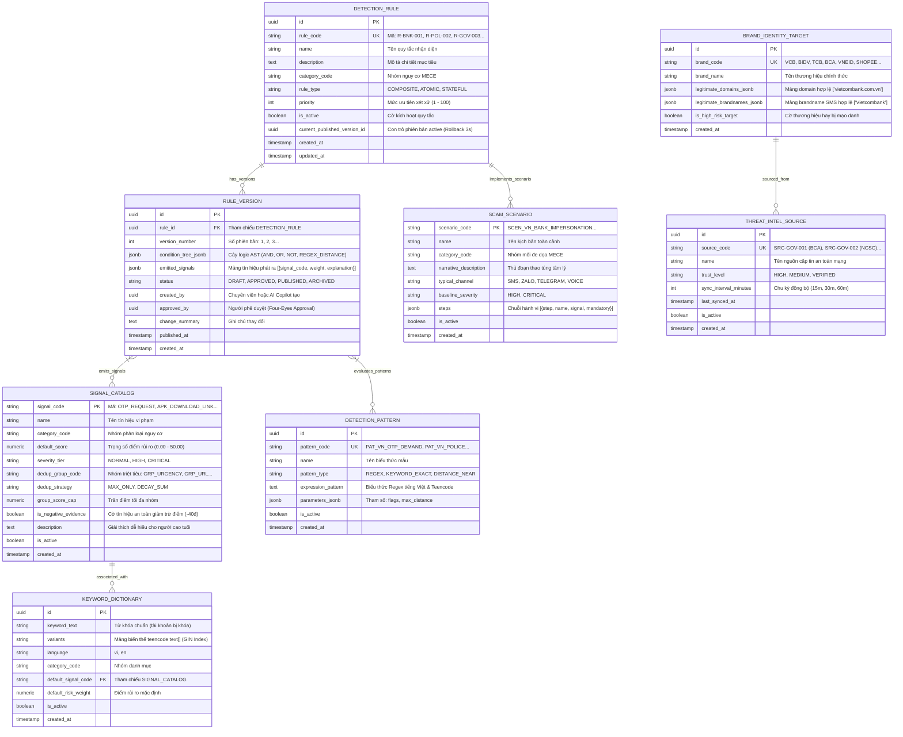
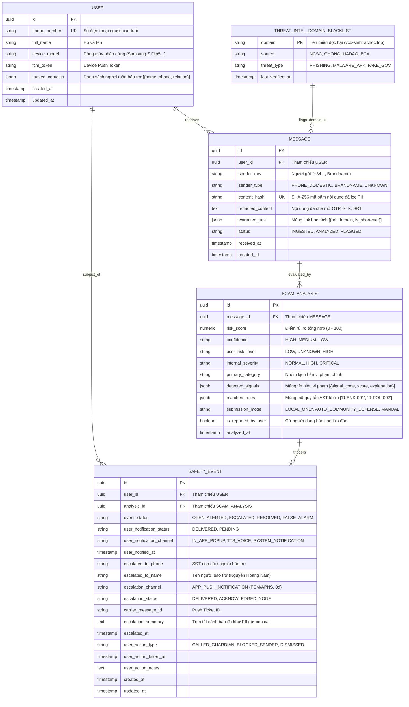
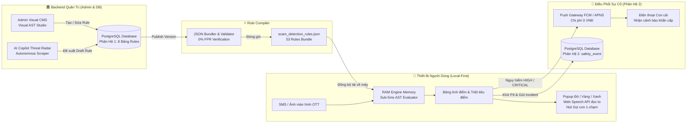

# Scam Message Detection — ERD & Data Model Specification
## Architecture Specification — Phiên bản 3.0 (Two-Subsystem Document-Relational Hybrid Schema)

> **Thông tin tài liệu:**  
> - **Phiên bản:** v3.0 (Toàn diện Hai Phân Hệ: Quản Trị Quy Tắc Admin & Vận Hành Sự Cố Runtime)  
> - **Cập nhật:** Tháng 10/2026 — Senior Data Architect & Security Solution Architect  
> - **Tiêu chuẩn:** PostgreSQL 16+ với Native JSONB, Envelope Encryption & Local-First Zero Raw Storage  
> - **Tài liệu liên quan:**  
>   - [PRD: Đặc tả Yêu cầu Sản phẩm](file:///d:/Me%20mine/PM/UXCamp/Scam%20alert/scam_alert_check_link_4/docs/PRD.md)  
>   - [Báo cáo Kiểm thử & Hiệu chuẩn](file:///d:/Me%20mine/PM/UXCamp/Scam%20alert/scam_alert_check_link_4/docs/Test_Report.md)  
>   - [Sổ tay Giải thích Kiến trúc Rule Engine AST](file:///d:/Me%20mine/PM/UXCamp/Scam%20alert/scam_alert_check_link_4/docs/Rule_Engine_Architecture_Guide.md)  
>   - [Báo cáo Mở rộng Kịch bản Lừa đảo](file:///d:/Me%20mine/PM/UXCamp/Scam%20alert/scam_alert_check_link_4/docs/Scam_Scenarios_Expansion_Report.md)  
>   - [Ma trận Bao phủ MECE](file:///d:/Me%20mine/PM/UXCamp/Scam%20alert/scam_alert_check_link_4/docs/MECE_Coverage_Matrix.md)  

---

## 1. Tổng Quan Kiến Trúc Dữ Liệu Hai Phân Hệ (Two-Subsystem Overview)

Để đồng thời đáp ứng hai yêu cầu kỹ thuật đối lập:
1. **Phía Client (Người dùng cao tuổi):** Cần tốc độ phát hiện tức thì (< 5ms), hoạt động hoàn toàn offline không cần mạng, và bảo mật quyền riêng tư tuyệt đối (Zero Raw Storage: không gửi SMS riêng tư lên Cloud).
2. **Phía Admin / Chuyên viên An toàn thông tin:** Cần quản trị vòng đời quy tắc linh hoạt (Thêm / Bớt / Xóa / Sửa rules, patterns, signals), thử nghiệm trực quan không cần code và có khả năng **Rollback hoàn tác trong 3 giây** nếu phát sinh báo động giả.

Hệ thống được tổ chức thành **Hai Phân Hệ Cơ Sở Dữ Liệu Chuyên Biệt**:

```text
┌────────────────────────────────────────────────────────────────────────────────────────┐
│               🏛️ PHÂN HỆ 1: RULE GOVERNANCE & KNOWLEDGE CATALOG                        │
│               (Cơ sở Dữ liệu Quản trị Tri thức & Quy tắc Phát hiện - Admin)             │
│                                                                                        │
│  [detection_rule] ──< [rule_version] (Cây AST condition_tree_jsonb, emitted_signals)  │
│  [signal_catalog] ── (104 tín hiệu rủi ro, điểm số, dedup_group_code, group_score_cap)│
│  [detection_pattern] ── (373 biểu thức Regex & mẫu từ khóa hành văn)                   │
│  [keyword_dictionary] ── (Từ khóa tiếng Việt, teencode variants text[])                │
│  [scam_scenario] ── (Kịch bản hành vi đa bước steps jsonb)                             │
│  [brand_identity_target] ── (Whitelist tên miền, brandname được bảo vệ)               │
│  [threat_intel_source] ── (Nguồn cấp dữ liệu BCA, NCSC, Chống Lừa Đảo)                 │
└──────────────────────────────────────────┬─────────────────────────────────────────────┘
                                           │
                             Biên dịch (Compile Bundle)
                                           ▼
┌────────────────────────────────────────────────────────────────────────────────────────┐
│               ⚡ GÓI TĨNH LOCAL-FIRST (scam_detection_rules.json)                       │
│               Đóng gói 53 Rules + Signals nạp sẵn trên RAM điện thoại (< 5ms)          │
└──────────────────────────────────────────┬─────────────────────────────────────────────┘
                                           │
                           Phân tích & Leo thang Sự cố
                                           ▼
┌────────────────────────────────────────────────────────────────────────────────────────┐
│               📱 PHÂN HỆ 2: OPERATIONAL RUNTIME & INCIDENT HUB                         │
│               (Cơ sở Dữ liệu Giao dịch & Quản trị Sự cố Gia đình - Runtime)            │
│                                                                                        │
│  [user] ─────────< [message] (Nội dung đã lọc PII, content_hash SHA-256)              │
│    │                  │                                                                │
│    │                  ▼                                                                │
│    │             [scam_analysis] (Log kiểm toán bất biến, matched_rules, signals)      │
│    │                  │                                                                │
│    └─────────────< [safety_event] (Unified Incident Hub: cảnh báo nạn nhân & con cái)  │
│                                                                                        │
│  [threat_intel_domain_blacklist] (Bộ nhớ đệm domain độc hại tự động sync mỗi 30 phút)   │
└────────────────────────────────────────────────────────────────────────────────────────┘
```

---

## 2. Sơ Đồ ERD Phân Hệ 1: Quản Trị Quy Tắc & Tri Thức Lừa Đảo (Admin Catalog)

Đây là phân hệ quản trị tập trung tại Backend dành cho **Admin, Product Manager, Security Analyst và AI Copilot Radar** để cấu hình, kiểm thử và ban hành quy tắc phát hiện:



---

## 3. Sơ Đồ ERD Phân Hệ 2: Giao Dịch Người Dùng & Sự Cố Runtime (Operational Hub)

Đây là phân hệ lưu trữ dữ liệu người dùng cuối, tuân thủ nguyên tắc **Zero Raw Storage** (không lưu SMS thô) và quản trị trung tâm sự cố bảo trợ người thân (Unified Incident Hub):



---

## 4. Cầu Nối Kiến Trúc: Cơ Chế Biên Dịch Bundle & Local-First Engine



---

## 5. Từ Điển Dữ Liệu Chi Tiết (Data Dictionary)

### 5.1 Bảng Quản Trị Quy Tắc (Phân Hệ 1)

#### Bảng `detection_rule` (Danh mục Quy tắc Lõi)
| Cột | Kiểu dữ liệu | Ràng buộc | Ý nghĩa nghiệp vụ |
| :--- | :--- | :--- | :--- |
| `id` | `UUID` | PK, DEFAULT `gen_random_uuid()` | Khóa chính duy nhất của quy tắc |
| `rule_code` | `VARCHAR(64)` | UNIQUE, NOT NULL | Mã nhận diện quy tắc (`R-BNK-001`, `R-POL-002`, `R-GOV-003`...) |
| `name` | `VARCHAR(256)` | NOT NULL | Tên quy tắc hiển thị quản trị |
| `description` | `TEXT` | NULLABLE | Mô tả chi tiết thủ đoạn và mục tiêu nhận diện |
| `category_code` | `VARCHAR(64)` | NOT NULL | Phân loại theo 13 nhóm nguy cơ MECE |
| `rule_type` | `VARCHAR(32)` | NOT NULL DEFAULT `'COMPOSITE'` | Loại luật: `COMPOSITE` (Cây AST đa điều kiện), `STATEFUL` (Hội thoại) |
| `priority` | `INT` | NOT NULL DEFAULT `50` | Thứ tự ưu tiên đánh giá (từ 1 đến 100) |
| `is_active` | `BOOLEAN` | NOT NULL DEFAULT `TRUE` | Bật/tắt quy tắc mà không cần xóa dữ liệu |
| `current_published_version_id`| `UUID` | NULLABLE | **Con trỏ phiên bản active: Cho phép Rollback trong 3 giây** |
| `created_at` / `updated_at` | `TIMESTAMPTZ` | DEFAULT `NOW()` | Dấu thời gian tạo và cập nhật |

#### Bảng `rule_version` (Phiên bản Cây Logic AST & Tín hiệu Nhúng)
| Cột | Kiểu dữ liệu | Ràng buộc | Ý nghĩa nghiệp vụ |
| :--- | :--- | :--- | :--- |
| `id` | `UUID` | PK, DEFAULT `gen_random_uuid()` | Khóa chính của phiên bản quy tắc |
| `rule_id` | `UUID` | FK `detection_rule.id`, NOT NULL | Tham chiếu tới quy tắc cha |
| `version_number` | `INT` | NOT NULL | Số thứ tự phiên bản tăng dần (1, 2, 3...) |
| `condition_tree_jsonb` | `JSONB` | NOT NULL | **Cây biểu thức logic AST (AND / OR / NOT / REGEX_DISTANCE)** |
| `emitted_signals` | `JSONB` | NOT NULL DEFAULT `'[]'` | Danh sách tín hiệu rủi ro phát ra khi rule khớp |
| `status` | `VARCHAR(32)` | DEFAULT `'DRAFT'` | Trạng thái: `DRAFT`, `APPROVED`, `PUBLISHED`, `ARCHIVED` |
| `created_by` | `UUID` | NULLABLE | Chuyên viên hoặc AI Copilot tạo bản thảo |
| `approved_by` | `UUID` | NULLABLE | Người phê duyệt bản thảo (Cơ chế Four-Eyes Approval) |
| `change_summary` | `TEXT` | NULLABLE | Ghi chú lý do thay đổi giữa các phiên bản |
| `published_at` | `TIMESTAMPTZ` | NULLABLE | Thời điểm phát hành ra môi trường Production |

#### Bảng `signal_catalog` (Từ Điển Tín Hiệu Rủi Ro & Chiến Lược Triệt Tiêu Điểm)
| Cột | Kiểu dữ liệu | Ràng buộc | Ý nghĩa nghiệp vụ |
| :--- | :--- | :--- | :--- |
| `signal_code` | `VARCHAR(64)` | PK | Mã tín hiệu rủi ro (`OTP_REQUEST`, `APK_DOWNLOAD_LINK`...) |
| `name` | `VARCHAR(128)` | NOT NULL | Tên tín hiệu bằng tiếng Việt |
| `category_code` | `VARCHAR(64)` | NOT NULL | Nhóm phân loại nghiệp vụ |
| `default_score` | `NUMERIC(5,2)` | NOT NULL | Điểm đóng góp mặc định (ví dụ: `40.00đ`, `50.00đ`) |
| `severity_tier` | `VARCHAR(16)` | DEFAULT `'HIGH'` | Mức độ nghiêm trọng: `NORMAL`, `HIGH`, `CRITICAL` |
| `dedup_group_code` | `VARCHAR(64)` | NULLABLE | Nhóm triệt tiêu điểm (`GRP_URGENCY`, `GRP_URL_RISK`...) |
| `dedup_strategy` | `VARCHAR(16)` | DEFAULT `'MAX_ONLY'` | Thuật toán triệt tiêu: `MAX_ONLY`, `DECAY_SUM` (hệ số 50%) |
| `group_score_cap` | `NUMERIC(5,2)` | NULLABLE | Trần điểm tối đa của nhóm (tránh thổi phồng điểm ảo) |
| `is_negative_evidence`| `BOOLEAN` | DEFAULT `FALSE` | Cờ tín hiệu an toàn chính thống: Giảm trừ điểm (-40đ) |
| `description` | `TEXT` | NULLABLE | Lời giải thích dễ hiểu hiển thị cho người cao tuổi |

#### Bảng `detection_pattern` (Thư viện Biểu Thức Regex Tái Sử Dụng)
| Cột | Kiểu dữ liệu | Ràng buộc | Ý nghĩa nghiệp vụ |
| :--- | :--- | :--- | :--- |
| `id` | `UUID` | PK, DEFAULT `gen_random_uuid()` | Khóa chính |
| `pattern_code` | `VARCHAR(64)` | UNIQUE, NOT NULL | Mã mẫu regex (`PAT_VN_OTP_DEMAND`, `PAT_VN_BANK_URGENCY`...) |
| `name` | `VARCHAR(128)` | NOT NULL | Tên mô tả mẫu biểu thức |
| `pattern_type` | `VARCHAR(32)` | DEFAULT `'REGEX'` | Loại mẫu: `REGEX`, `KEYWORD_EXACT`, `DISTANCE_NEAR` |
| `expression_pattern` | `TEXT` | NOT NULL | Biểu thức Regex hỗ trợ Unicode & Teencode tiếng Việt |
| `parameters_jsonb` | `JSONB` | DEFAULT `'{"flags": "i"}'`| Cấu hình cờ regex hoặc khoảng cách `max_distance` |
| `is_active` | `BOOLEAN` | DEFAULT `TRUE` | Cờ kích hoạt |

---

### 5.2 Bảng Giao Dịch & Sự Cố Runtime (Phân Hệ 2)

#### Bảng `user`
| Cột | Kiểu dữ liệu | Ràng buộc | Ý nghĩa nghiệp vụ |
| :--- | :--- | :--- | :--- |
| `id` | `UUID` | PK, DEFAULT `gen_random_uuid()` | Định danh người cao tuổi |
| `phone_number` | `VARCHAR(20)` | UNIQUE, NOT NULL | Số điện thoại đăng ký bảo vệ |
| `full_name` | `VARCHAR(100)` | NULLABLE | Tên người dùng |
| `device_model` | `VARCHAR(50)` | NULLABLE | Dòng máy (Samsung Galaxy Z Flip5...) |
| `fcm_token` | `TEXT` | NULLABLE | Push Token thiết bị |
| `trusted_contacts` | `JSONB` | DEFAULT `'[]'` | Danh bạ con cái: `[{"name": "...", "phone": "...", "relation": "Con trai"}]` |

#### Bảng `message` (Zero Raw Storage)
| Cột | Kiểu dữ liệu | Ràng buộc | Ý nghĩa nghiệp vụ |
| :--- | :--- | :--- | :--- |
| `id` | `UUID` | PK, DEFAULT `gen_random_uuid()` | Mã bản ghi tin nhắn |
| `user_id` | `UUID` | FK `user.id`, NOT NULL | Nạn nhân nhận tin nhắn |
| `sender_raw` | `VARCHAR(50)` | NOT NULL | Người gửi thô (+84..., Brandname) |
| `sender_type` | `VARCHAR(30)` | NOT NULL | `PHONE_DOMESTIC`, `BRANDNAME`, `UNKNOWN` |
| `content_hash` | `CHAR(64)` | NOT NULL, INDEX | SHA-256 mã băm nội dung đã lọc sạch PII |
| `redacted_content` | `TEXT` | NOT NULL | Nội dung đã che mờ OTP, STK, SĐT |
| `extracted_urls` | `JSONB` | DEFAULT `'[]'` | Danh sách link bóc tách |

#### Bảng `scam_analysis` (Audit Log Bất Biến)
| Cột | Kiểu dữ liệu | Ràng buộc | Ý nghĩa nghiệp vụ |
| :--- | :--- | :--- | :--- |
| `id` | `UUID` | PK, DEFAULT `gen_random_uuid()` | Mã kiểm toán phân tích |
| `message_id` | `UUID` | FK `message.id`, NOT NULL | Tin nhắn được đánh giá |
| `risk_score` | `NUMERIC(5,2)` | NOT NULL | Điểm số rủi ro (0.00 - 100.00) |
| `confidence` | `VARCHAR(10)` | NOT NULL | Độ tự tin: `HIGH`, `MEDIUM`, `LOW` |
| `user_risk_level` | `VARCHAR(10)` | NOT NULL | **Mức hiển thị người dùng: LOW, UNKNOWN, HIGH** |
| `internal_severity`| `VARCHAR(20)` | NOT NULL | Mức độ nội bộ: `NORMAL`, `HIGH`, `CRITICAL` |
| `primary_category` | `VARCHAR(50)` | NOT NULL | Phân loại kịch bản vi phạm |
| `detected_signals` | `JSONB` | DEFAULT `'[]'` | Bằng chứng vi phạm kèm điểm số |
| `matched_rules` | `JSONB` | DEFAULT `'[]'` | Danh sách mã luật AST khớp |

#### Bảng `safety_event` (Unified Incident Hub)
| Cột | Kiểu dữ liệu | Ràng buộc | Ý nghĩa nghiệp vụ |
| :--- | :--- | :--- | :--- |
| `id` | `UUID` | PK, DEFAULT `gen_random_uuid()` | Mã sự cố khẩn cấp |
| `user_id` | `UUID` | FK `user.id`, NOT NULL | Nạn nhân |
| `analysis_id` | `UUID` | FK `scam_analysis.id`, NOT NULL | Cơ sở đánh giá rủi ro |
| `event_status` | `VARCHAR(20)` | DEFAULT `'OPEN'` | `OPEN`, `ALERTED`, `ESCALATED`, `RESOLVED`, `FALSE_ALARM` |
| `user_notification_channel` | `VARCHAR(30)` | NULLABLE | Kênh: `IN_APP_POPUP`, `TTS_VOICE` |
| `escalated_to_phone` | `VARCHAR(20)` | NULLABLE | Số điện thoại con cái nhận push |
| `escalated_to_name` | `VARCHAR(100)` | NULLABLE | Tên người nhận (Nguyễn Hoàng Nam) |
| `escalation_channel` | `VARCHAR(30)` | NULLABLE | `APP_PUSH_NOTIFICATION` (Chi phí 0 VNĐ) |
| `escalation_status` | `VARCHAR(20)` | DEFAULT `'NONE'` | `DELIVERED`, `ACKNOWLEDGED`, `NONE` |
| `carrier_message_id` | `VARCHAR(100)` | NULLABLE | Ticket ID push notification |
| `user_action_type` | `VARCHAR(30)` | NULLABLE | Phản ứng: `CALLED_GUARDIAN`, `BLOCKED_SENDER`, `DISMISSED` |

---

## 6. Cơ Chế Quản Trị Admin & Zero-Downtime Rollback

1. **Thêm / Sửa / Thử nghiệm Rule:** Admin sử dụng Visual AST Studio (`admin_cms.html`) kéo thả cây điều kiện hoặc phê duyệt bản thảo do AI Copilot Radar tự động cào từ báo chí (VnExpress, Dân Trí, Cổng BCA).
2. **Xuất bản không gián đoạn (Zero-Downtime Publish):** Khi bấm "Publish", backend tự động cập nhật bản ghi mới vào `rule_version` và trỏ con trỏ `current_published_version_id` của `detection_rule` sang ID mới.
3. **Rollback trong 3 giây:** Nếu phát hiện quy tắc mới gây báo động nhầm, Admin chỉ cần chuyển con trỏ `current_published_version_id` về phiên bản cũ:
   ```sql
   UPDATE detection_rule 
   SET current_published_version_id = 'b1000000-0000-0000-0000-000000000001'
   WHERE rule_code = 'R-BNK-002';
   ```
   Hệ thống tự động biên dịch lại gói JSON và đẩy bản vá xuống máy người dùng mà không cần sửa code hay khởi động lại server.

---

## 7. DDL SQL Khởi Tạo Cả Hai Phân Hệ (PostgreSQL 16+)

Tệp migration và seed data hoàn chỉnh đã sẵn sàng tại [`scam_detection_seed_data.sql`](file:///d:/Me%20mine/PM/UXCamp/Scam%20alert/scam_alert_check_link_4/scam_detection_seed_data.sql) với đầy đủ 13 bảng thuộc cả 2 phân hệ.
