# Sơ Đồ Tư Duy Ngược (Reverse Architecture Mind Map)
## Từ Outcome Tối Thượng Đến Triển Khai Kỹ Thuật

> **Phương pháp tiếp cận:** Đi ngược từ **Desired Outcome** $\to$ **Hành vi cần ngăn chặn** $\to$ **Quyết định người dùng** $\to$ **Thông tin & Cảnh báo** $\to$ **Tín hiệu quan sát** $\to$ **Cơ chế phát hiện** $\to$ **Thành phần kỹ thuật** $\to$ **Mô hình dữ liệu**.

---

## 1. Sơ Đồ Tư Duy Ngược Toàn Diện (Mermaid Mindmap)

```mermaid
graph TD
    classDef outcome fill:#15803d,stroke:#166534,stroke-width:2px,color:#fff;
    classDef harm fill:#b91c1c,stroke:#991b1b,stroke-width:2px,color:#fff;
    classDef action fill:#d97706,stroke:#b45309,stroke-width:2px,color:#fff;
    classDef info fill:#2563eb,stroke:#1d4ed8,stroke-width:2px,color:#fff;
    classDef signal fill:#7c3aed,stroke:#6d28d9,stroke-width:2px,color:#fff;
    classDef tech fill:#0f172a,stroke:#334155,stroke-width:1px,color:#fff;
    classDef gap fill:#dc2626,stroke:#991b1b,stroke-width:2px,stroke-dasharray: 5 5,color:#fff;
    classDef optional fill:#475569,stroke:#334155,stroke-width:1px,stroke-dasharray: 3 3,color:#fff;

    OUTCOME["OUTCOME TỐI THƯỢNG:\nGiảm thiệt hại tài sản, danh tính\nvà tổn thương tâm lý cho người già"]:::outcome

    %% HÀNH VI NGUY HIỂM CẦN NGĂN CHẶN
    OUTCOME --> HARM1["Hành vi 1: Nhập mã OTP / Mật khẩu vào website lạ"]:::harm
    OUTCOME --> HARM2["Hành vi 2: Chuyển tiền vào STK lạ dưới áp lực thúc ép"]:::harm
    OUTCOME --> HARM3["Hành vi 3: Tải & Cấp quyền Accessibility cho file APK"]:::harm
    OUTCOME --> HARM4["Hành vi 4: Tin tưởng kẻ mạo danh & giấu con cái"]:::harm

    %% QUYẾT ĐỊNH CỦA NGƯỜI DÙNG CẦN TÁC ĐỘNG
    HARM1 --> DEC1["Quyết định: DỪNG LẠI (Pause) không nhập OTP, không click link"]:::action
    HARM2 --> DEC2["Quyết định: GỌI ĐIỆN THOẠI thoại SIM kiểm chứng con cái"]:::action
    HARM3 --> DEC3["Quyết định: TỪ CHỐI bấm cài đặt APK / Tắt cảnh báo Play Protect"]:::action
    HARM4 --> DEC4["Quyết định: HỎI Ý KIẾN người thân bảo trợ (Family Shield)"]:::action

    %% THÔNG TIN CẦN NHẬN ĐƯỢC
    DEC1 --> INF1["Cảnh báo đỏ + Giải thích 'Ngân hàng không bao giờ gửi link đòi OTP'"]:::info
    DEC2 --> INF2["Cảnh báo nghi ngờ + Lời khuyên gọi SIM trực tiếp cho người gửi"]:::info
    DEC3 --> INF3["Cảnh báo nguy cấp: 'Công an không gửi link cài app qua SMS'"]:::info
    DEC4 --> INF4["Nút bấm 1 chạm: 'Nhờ con kiểm tra hộ' / Tự động báo con khi nguy cấp"]:::info

    %% TÍN HIỆU CẦN QUAN SÁT
    INF1 --> SIG1["Tín hiệu: Đòi OTP + Domain lạ + Giả mạo Brandname"]:::signal
    INF2 --> SIG2["Tín hiệu: Mượn tiền gấp + STK ngân hàng lạ + Tránh nghe máy"]:::signal
    INF3 --> SIG3["Tín hiệu: Đe dọa pháp lý/sổ đỏ + Link tải đuôi .apk"]:::signal
    INF4 --> SIG4["Tín hiệu: Rủi ro CRITICAL (Score >= 75 + Mối nguy mất quyền máy/tiền)"]:::signal

    %% CƠ CHẾ PHÁT HIỆN
    SIG1 --> DET1["Cơ chế: Normalization + Blacklist URL NCSC + AST (AND/NOT)"]:::tech
    SIG2 --> DET2["Cơ chế: Stateful Conversation Store (theo dõi chuỗi 3 ngày)"]:::tech
    SIG3 --> DET3["Cơ chế: Regex Distance (bắt cặp từ khóa) + Extension .apk check"]:::tech
    SIG4 --> DET4["Cơ chế: Policy Triệt tiêu (Decay 50%) + Severity Routing"]:::tech

    %% THÀNH PHẦN KỸ THUẬT HIỆN CÓ
    DET1 --> COMP1["Code: test_rule_engine.js + scam_url_domain_indicators.csv"]:::tech
    DET2 --> COMP2["Code: ConversationStore (in-memory Map trong test_rule_engine.js)"]:::tech
    DET3 --> COMP3["Code: evaluateCondition (toán tử REGEX_DISTANCE)"]:::tech
    DET4 --> COMP4["Code: server/notification_service.js + server/app.js"]:::tech

    %% KHOẢNG TRỐNG (GAPS - THIẾU SÓT THỰC TẾ)
    HARM2 -.-> GAP_TELCO["GAP: Kẻ lừa đảo gọi điện thoại trực tiếp (Voice Call) -> App SMS mù hoàn toàn!"]:::gap
    HARM1 -.-> GAP_OS["GAP: Chưa có Android Accessibility Service / iOS Filter chặn click link thật!"]:::gap
    HARM3 -.-> GAP_APK["GAP: Chưa có cơ chế can thiệp khi file APK bắt đầu được tải xuống!"]:::gap
    HARM4 -.-> GAP_FAMILY["GAP: Con cái nhận SMS cảnh báo nhưng không thể khóa máy bố mẹ từ xa!"]:::gap

    %% THÀNH PHẦN CHƯA CHỨNG MINH ĐƯỢC GIÁ TRỊ (OVER-ENGINEERED)
    DET1 -.-> OPT1["Thành phần dư thừa: Cloud K-Anonymity Hash-Prefix (chưa có Cloud server thật)"]:::optional
    DET1 -.-> OPT2["Thành phần dư thừa: Bloom Filter 2048 bits (chỉ chứa ~10 domain)"]:::optional
    DET4 -.-> OPT3["Thành phần dư thừa: 23 Bảng ERD quan hệ (Production chỉ dùng 4 object JSON)"]:::optional
```

---

## 2. Bảng Đối Chiếu Thành Phần Hiện Có (Audit Value Matrix)

| Thành Phần Hiện Có | Giải quyết vấn đề gì? | Cần thiết trong mọi trường hợp? | Thành phần khác làm cùng việc? | Nếu xóa đi, hệ thống hỏng thế nào? | Có thể thay bằng cơ chế đơn giản hơn? | Rủi ro & Chi phí vận hành tăng thêm | Đã chứng minh cải thiện Outcome? |
| :--- | :--- | :---: | :---: | :--- | :--- | :--- | :---: |
| **`test_rule_engine.js` (AST Engine + Normalization)** | Chuẩn hóa tiếng Việt, khử teencode, đánh giá AST logic `AND/OR/NOT/REGEX_DISTANCE`. | **CÓ** (Bắt buộc) | Không | Không phân tích được tin nhắn; toàn bộ hệ thống dừng hoạt động. | Không, Regex kết hợp AST đơn giản là phương án tối ưu về tài nguyên trên mobile. | Thấp. Cần bảo trì từ điển regex khi thủ đoạn thay đổi. | **CÓ** (Đạt Precision 100% trên 24 test cases). |
| **`scam_url_domain_indicators.csv`** | Tra cứu danh sách đen tên miền đã xác minh từ NCSC/ChốngLừaĐảo. | **CÓ** | Không | Không phát hiện được các domain lừa đảo tinh vi không có từ khóa lộ liễu. | Không, đây là nguồn tri thức xác thực cao nhất. | Thấp (chỉ tốn dung lượng file CSV ~5KB). | **CÓ** (Bắt trúng 100% các URL độc hại đã biết). |
| **`ConversationStore` (Stateful Engine)** | Phát hiện bẫy lừa đảo nuôi dài ngày (Pig-butchering) qua nhiều tin nhắn. | **TÙY CHỌN** (Chỉ cho tin nhắn cùng người gửi) | Không | Bỏ sót các ca làm quen hôm trước, hôm sau mới mượn tiền (TC-REL-001/002). | Có thể dùng SQLite cục bộ trên Android thay vì in-memory Map. | Bộ nhớ RAM có thể phình to nếu người dùng nhận hàng nghìn SMS rác mỗi tháng. | **CÓ** (Đã chứng minh bắt chuỗi 3 ngày tại test case). |
| **`Bloom Filter & K-Anonymity`** | Bảo vệ quyền riêng tư khi tra cứu Cloud cho 2% domain lạ. | **CHƯA CẦN** (Dư thừa hiện tại) | Không | Không ảnh hưởng gì vì 100% domain hiện tại đã nằm trong local file CSV! | Thay bằng local SQLite hoặc binary hash trie trên client. | Làm phức tạp code, gây ảo tưởng về một hệ thống Cloud-assisted chưa tồn tại. | **CHƯA** (Chưa có Cloud endpoint thật tiếp nhận hash prefix). |
| **`server/notification_service.js`** | Gửi SMS cảnh báo khẩn cấp cho con cái (`Brandname: SCAMSHIELD`). | **CÓ** (Tối quan trọng cho người già) | Không | Người già bị lừa trong âm thầm, con cái không biết để can thiệp. | Giữ nguyên logic, nhưng cần tích hợp qua SMS Brandname Telco thật. | Tốn chi phí viễn thông (~300-500đ/tin SMS gửi cho người thân). | **CÓ** (Tạo lớp can thiệp con cháu bảo trợ). |
| **`admin_cms.html` (Visual AST Builder)** | Cho phép chuyên viên tạo/sửa rule kéo thả không cần đụng code. | **CÓ** (Dành cho SecOps/PM) | Sửa file JSON tay | Phải sửa thủ công `scam_detection_rules.json`, dễ gây lỗi cú pháp JSON. | Có thể duy trì dạng Web tool nhẹ nhàng như hiện tại. | Thấp (hoạt động hoàn toàn phía Client qua REST API). | **CÓ** (Rút ngắn thời gian ban hành rule mới từ vài ngày xuống 5 phút). |
| **Hệ thống 23 bảng trong `ERD.md`** | Đặc tả quan hệ dữ liệu cho môi trường Enterprise PostgreSQL. | **KHÔNG** (Dư thừa ở pha hiện tại) | Bảng `db_store.json` đã gộp 4 bảng chính | Không hỏng! Thực tế code chạy 100% mượt mà chỉ với 4 entities: `user`, `message`, `scam_analysis`, `safety_event`. | Thay hoàn toàn bằng **Document-Relational Hybrid (4 thực thể)**. | Phân mảnh dữ liệu, tốn công JOIN bảng, tăng độ trễ và chi phí hạ tầng DB. | **CHƯA** (Mô hình 23 bảng chưa từng chạy trong code thực thi). |
