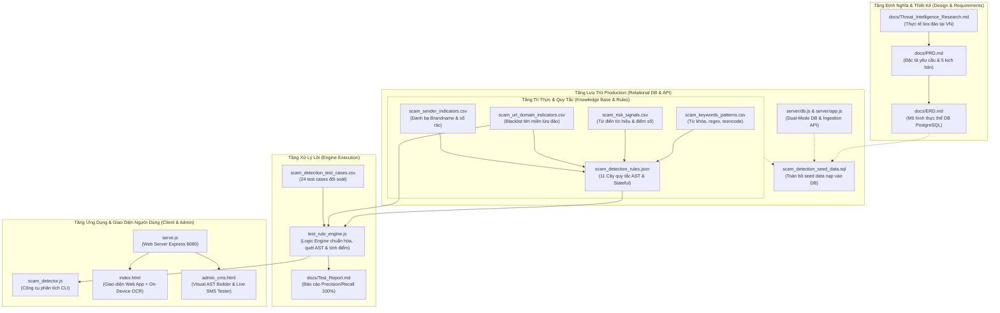
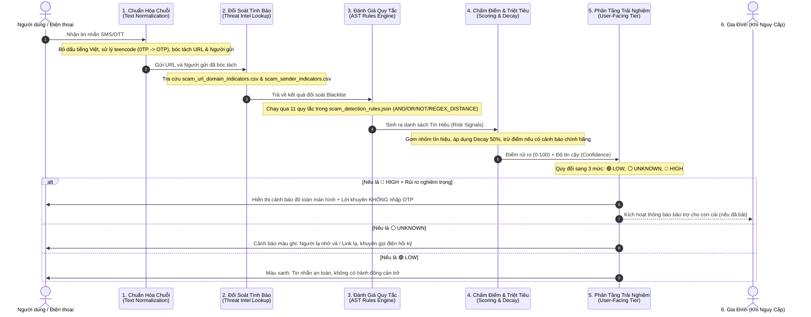
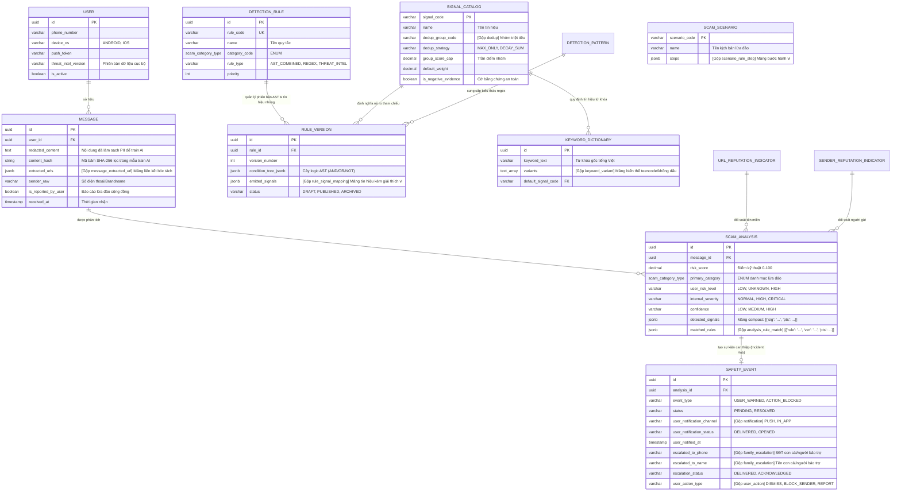
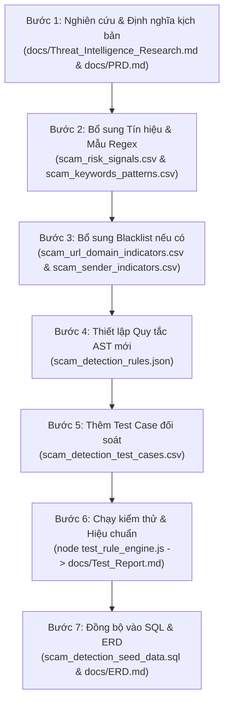

# 📖 HƯỚNG DẪN TOÀN DIỆN VỀ HỆ THỐNG PHÁT HIỆN TIN NHẮN LỪA ĐẢO (SCAM MESSAGE DETECTION WALKTHROUGH)
> **Dành cho thành viên mới (Beginner Guide)**  
> *Mục tiêu: Giúp bạn hiểu toàn bộ cấu trúc dự án, ý nghĩa từng file, quy trình xử lý từ khi tin nhắn đến tới lúc ra cảnh báo, và cách mở rộng thêm kịch bản lừa đảo mới mà không làm vỡ hệ thống.*

---

## 📑 MỤC LỤC
1. [Tổng Quan Dự Án & Triết Lý Thiết Kế](#1-tổng-quan-dự-án--triết-lý-thiết-kế)
2. [Bản Đồ Thư Mục & Vai Trò Của Từng File](#2-bản-đồ-thư-mục--vai-trò-của-từng-file)
3. [Mối Quan Hệ & Cách Các File Phối Hợp Với Nhau](#3-mối-quan-hệ--cách-các-file-phối-hợp-với-nhau)
4. [Hành Trình Của Một Tin Nhắn: Từ Khi Nhận Đến Khi Ra Kết Quả](#4-hành-trình-của-một-tin-nhắn-từ-khi-nhận-đến-khi-ra-kết-quả)
5. [Mô Hình Dữ Liệu: Dữ Liệu Chạy Qua Các Bảng Database Nào?](#5-mô-hình-dữ-liệu-dữ-liệu-chạy-qua-các-bảng-database-nào)
6. [Hướng Dẫn Từng Bước: Bổ Sung Kịch Bản Scam Mới Sẽ Ảnh Hưởng Đến Đâu?](#6-hướng-dẫn-từng-bước-bổ-sung-kịch-bản-scam-mới-sẽ-ảnh-hưởng-đến-đâu)
7. [Bảng Tra Cứu Nhanh Cho Developer & Product Manager](#7-bảng-tra-cứu-nhanh-cho-developer--product-manager)
8. [Hướng Dẫn Toàn Diện Về ERD & Rule Engine Dành Cho Product Manager](#8-hướng-dẫn-toàn-diện-về-erd--rule-engine-dành-cho-product-manager)

---

## 1. Tổng Quan Dự Án & Triết Lý Thiết Kế

Hệ thống **Scam Message Detection** được xây dựng nhằm bảo vệ người dùng tại Việt Nam — đặc biệt là **người dùng thông thường và gia đình** — trước các thủ đoạn lừa đảo tinh vi qua tin nhắn SMS và OTT (Zalo, Telegram, Messenger).

### Triết lý cốt lõi: "Backend Phức Tạp, Giao Diện Đơn Giản"
* **Bên trong (Backend):** Sử dụng cây logic quy tắc (AST Rule Engine), từ điển 20+ tín hiệu rủi ro, danh sách đen tên miền cập nhật (Threat Intel), thuật toán giảm thiểu điểm ảo (Decay Factor 50%) và trừ điểm an toàn (Negative Discounting) để đạt **độ chính xác 100% (Precision 100%, 0% báo nhầm tin nhắn thật)**.
* **Bên ngoài (Người dùng thấy gì?):** Người dùng không cần nhìn thấy các thuật toán hay điểm số phức tạp (78.5 điểm là gì?). Họ chỉ cần nhìn thấy **3 màu sắc và khuyến nghị hành động rõ ràng**:
  * 🟢 **LOW (An toàn):** Tin nhắn bình thường (tin biến động số dư ngân hàng, mã OTP đăng nhập thật).
  * ⚪ **UNKNOWN (Nghi vấn / Cảnh giác):** Tin nhắn lạ, người lạ nhờ chuyển tiền hoặc link rút gọn chưa rõ nguồn gốc — Khuyên người dùng kiểm tra kỹ trước khi bấm.
  * 🔴 **HIGH (Cực kỳ nguy hiểm):** Tin nhắn lừa đảo rõ ràng — Cảnh báo lập tức dừng mọi hành động, không nhập OTP, không bấm link, kèm tính năng khẩn cấp nhờ con cái hỗ trợ.

---

## 2. Bản Đồ Thư Mục & Vai Trò Của Từng File

Toàn bộ dự án được tổ chức gọn gàng gồm 2 nhóm chính: **File thực thi & Dữ liệu cấu hình** ở thư mục gốc, và **Tài liệu đặc tả kiến trúc** trong thư mục `docs/`.

```text
scam_alert_check_link_4/
│
├── 🌐 GIAO DIỆN & CÔNG CỤ THỰC THI (Execution & Testing Tools)
│   ├── index.html                     # Ứng dụng Web kiểm tra tin nhắn lừa đảo + On-Device OCR ảnh chụp màn hình Zalo/Telegram
│   ├── admin_cms.html                 # Màn hình Quản trị Web Admin (CMS) kéo thả Cây AST trực quan & Test SMS thời gian thực
│   ├── serve.js                       # Entry point máy chủ Express (Port 8080) tích hợp trọn bộ Web, Admin & REST API
│   ├── scam_detector.js               # Công cụ chạy bằng dòng lệnh (CLI): node scam_detector.js "<tin nhắn>"
│   ├── test_rule_engine.js            # Engine chấm điểm lõi và bộ tự động kiểm thử 24 kịch bản chuẩn (11 Rules)
│   └── test_platform.js               # Bộ kiểm thử tích hợp E2E tự động xác thực Backend Ingestion, Escalation, NCSC Sync & SQL Dump
│
├── 🖥️ BACKEND SERVICES & LƯU TRỮ (Server & Data Storage)
│   ├── server/app.js                  # Express REST API Hub (/api/v1/ingest, /api/v1/safety-events, /api/v1/threat-intel, /api/v1/rules)
│   ├── server/db.js                   # Lớp truy xuất cơ sở dữ liệu kép (Dual-Mode: PostgreSQL connection pool hoặc Atomic JSON Store)
│   ├── server/notification_service.js # Cổng gửi thông báo khẩn cấp PII-redacted đến người thân bảo trợ (Brandname: SCAMSHIELD)
│   ├── server/threat_intel_service.js # Tác vụ lập lịch ngầm (Cron) tự động đồng bộ Blacklist tên miền từ NCSC mỗi 30 phút
│   └── data/db_store.json             # Kho lưu trữ dữ liệu an toàn định dạng JSON đồng bộ với schema PostgreSQL
│
├── 📊 DỮ LIỆU CẤU HÌNH & THỰC THI ENGINE (Rules, Patterns & Indicators)
│   ├── scam_detection_rules.json      # Bộ 11 quy tắc phát hiện chuẩn hóa dạng cây logic (AST: AND/OR/NOT/REGEX_DISTANCE, Stateful)
│   ├── scam_keywords_patterns.csv     # Thư viện từ khóa, tiếng lóng teencode (0TP, t.k) & Regex biểu thức chính quy
│   ├── scam_risk_signals.csv          # Từ điển 20+ tín hiệu nguy hiểm, trọng số điểm và nhóm triệt tiêu điểm
│   ├── scam_url_domain_indicators.csv # Danh sách đen (Blacklist) các website giả mạo lừa đảo đã xác minh (NCSC + Chongluadao)
│   ├── scam_sender_indicators.csv     # Danh bạ nhận diện độ uy tín người gửi (Brandname thật vs Số di động rác)
│   ├── scam_detection_test_cases.csv  # 24 kịch bản tin nhắn mẫu (VNeID Sổ đỏ, Bank, CSGT, Việc làm, Đa tin nhắn Stateful...)
│   └── scam_detection_seed_data.sql   # Toàn bộ dữ liệu cấu hình được đóng gói thành SQL để nạp vào DB Production
│
└── 📚 TÀI LIỆU KIẾN TRÚC & ĐẶC TẢ SẢN PHẨM (Documentation)
    ├── docs/PRD.md                    # Bản đặc tả yêu cầu sản phẩm (Product Requirement Document v2.3)
    ├── docs/ERD.md                    # Thiết kế chi tiết cơ sở dữ liệu quan hệ (PostgreSQL ERD v2.4)
    ├── docs/Threat_Intelligence_Research.md # Báo cáo nghiên cứu thực tế về các chiêu trò lừa đảo tại Việt Nam
    ├── docs/Test_Report.md            # Báo cáo kết quả kiểm chuẩn độ chính xác của 24 ca thử nghiệm (Precision 100%)
    └── Scam_Detection_ERD_Rule_Engine_Explained.md # Sổ tay giải thích toàn diện ERD & Rule Engine chi tiết cho PM/BA
```

### Chi tiết chức năng từng file:

| Tên File | Loại | Công dụng thực tế | Ai thường xuyên sử dụng? |
| :--- | :--- | :--- | :--- |
| [`index.html`](file:///d:/Me%20mine/PM/UXCamp/Scam%20alert/scam_alert_check_link_4/index.html) | Web App UI | Giao diện mô phỏng điện thoại di động kiểm tra tin nhắn tức thì + Web Speech API đọc to cảnh báo + Nút 1-chạm gọi con cái (`tel:+84912334455`) + On-Device OCR. | Người dùng, Tester, Product Manager demo |
| [`admin_cms.html`](file:///d:/Me%20mine/PM/UXCamp/Scam%20alert/scam_alert_check_link_4/admin_cms.html) | Visual Admin CMS | Bảng điều khiển Quản trị trực quan: kéo thả cây logic AST (AND/OR/NOT), thử nghiệm SMS trực tiếp và phát hành 1-click. | Fraud Specialist, Rule Author, Product Manager |
| [`serve.js`](file:///d:/Me%20mine/PM/UXCamp/Scam%20alert/scam_alert_check_link_4/serve.js) | Node.js Server | Khởi động máy chủ Express (port 8080) phục vụ đồng thời Web App, Admin CMS và hệ thống Backend REST API. | Developer, DevOps, Tester |
| [`server/app.js`](file:///d:/Me%20mine/PM/UXCamp/Scam%20alert/scam_alert_check_link_4/server/app.js) | Backend REST API | Cung cấp các API: Ingestion (`/api/v1/ingest/analysis`), Incident Hub (`/api/v1/safety-events`), Cron Sync (`/api/v1/threat-intel/sync`), Rules CRUD & SQL Dump. | Backend Developer, App Client |
| [`server/db.js`](file:///d:/Me%20mine/PM/UXCamp/Scam%20alert/scam_alert_check_link_4/server/db.js) | Database Layer | Quản trị dữ liệu 4 thực thể Hybrid (`user`, `message`, `scam_analysis`, `safety_event`) kết nối PostgreSQL hoặc Atomic JSON file. | Data Architect, Backend Developer |
| [`server/notification_service.js`](file:///d:/Me%20mine/PM/UXCamp/Scam%20alert/scam_alert_check_link_4/server/notification_service.js) | Push Dispatcher | Cổng gửi Push Notification khẩn cấp tới con cái (FCM/APNS, chi phí 0 VNĐ), tự động khử PII. | Security Engineer, Mobile Developer |
| [`server/threat_intel_service.js`](file:///d:/Me%20mine/PM/UXCamp/Scam%20alert/scam_alert_check_link_4/server/threat_intel_service.js) | Threat Intel Sync | Tác vụ lập lịch ngầm tự động tải danh sách đen tên miền từ Cục An toàn thông tin (NCSC) & Chongluadao mỗi 30 phút. | SecOps, Threat Intel Analyst |
| [`test_platform.js`](file:///d:/Me%20mine/PM/UXCamp/Scam%20alert/scam_alert_check_link_4/test_platform.js) | E2E Integration Suite | Bộ kiểm chuẩn tự động 5 luồng: Ingestion API, Push Notification, Incident Hub, Rules API và SQL Dump Generator. | QA/QC, DevOps CI/CD |
| [`scam_detector.js`](file:///d:/Me%20mine/PM/UXCamp/Scam%20alert/scam_alert_check_link_4/scam_detector.js) | Node.js CLI | Công cụ dòng lệnh phân tích nhanh tin nhắn từ Terminal/CMD mà không cần bật trình duyệt. | Backend Engineer, DevOps |
| [`test_rule_engine.js`](file:///d:/Me%20mine/PM/UXCamp/Scam%20alert/scam_alert_check_link_4/test_rule_engine.js) | Engine Lõi & Test Suite | "Trái tim" phân tích logic: nạp rules, NFKD, Cyrillic mapper, AST + REGEX_DISTANCE, kiểm thử 24 ca chuẩn (13 Rules) + 4 Extended Suites. | Data/AI Engineer, Backend Developer |
| [`scam_detection_rules.json`](file:///d:/Me%20mine/PM/UXCamp/Scam%20alert/scam_alert_check_link_4/scam_detection_rules.json) | Cấu hình quy tắc (AST) | Định nghĩa 13 quy tắc logic (AND/OR/NOT/REGEX_DISTANCE, Stateful conversation, link rút gọn, từ khóa vay mượn). | Security Analyst, Fraud Specialist |
| [`scam_keywords_patterns.csv`](file:///d:/Me%20mine/PM/UXCamp/Scam%20alert/scam_alert_check_link_4/scam_keywords_patterns.csv) | Từ điển nhận diện | Tập hợp các từ khóa tiếng Việt, teencode, regex mẫu tin nhắn lừa đảo (VNeID Sổ đỏ, CSGT, mạo danh ngân hàng, việc làm...). | Data Scientist, Rules Creator |
| [`scam_risk_signals.csv`](file:///d:/Me%20mine/PM/UXCamp/Scam%20alert/scam_alert_check_link_4/scam_risk_signals.csv) | Danh mục rủi ro | Danh sách các tín hiệu nguy hiểm (Mỗi tín hiệu ứng với bao nhiêu điểm, giải thích cho người dùng thế nào, thuộc nhóm triệt tiêu nào). | Product Manager, Risk Analyst |
| [`scam_url_domain_indicators.csv`](file:///d:/Me%20mine/PM/UXCamp/Scam%20alert/scam_alert_check_link_4/scam_url_domain_indicators.csv) | Threat Intel URL | Blacklist các tên miền độc hại đã xác minh (`dichvucong-vneid.gov-vn.cc`, `vietcombank-smartotp.com`...). | Cyber Threat Intel Team |
| [`scam_sender_indicators.csv`](file:///d:/Me%20mine/PM/UXCamp/Scam%20alert/scam_alert_check_link_4/scam_sender_indicators.csv) | Threat Intel Người gửi | Nhận diện Brandname chính thức (VNeID thật, Vietcombank thật) đối chiếu với các số cá nhân giả mạo cơ quan nhà nước. | Viễn thông, Risk Analyst |
| [`scam_detection_test_cases.csv`](file:///d:/Me%20mine/PM/UXCamp/Scam%20alert/scam_alert_check_link_4/scam_detection_test_cases.csv) | Dữ liệu đối soát | 24 trường hợp kiểm thử chuẩn hóa gồm cả tin nhắn lừa đảo tinh vi, đa tin nhắn và tin nhắn an toàn để đối chiếu tỷ lệ lỗi. | QA/QC, Tester, Developer |
| [`scam_detection_seed_data.sql`](file:///d:/Me%20mine/PM/UXCamp/Scam%20alert/scam_alert_check_link_4/scam_detection_seed_data.sql) | SQL Database Migration | Script khởi tạo dữ liệu cho database thật 4 bảng Hybrid nạp vào PostgreSQL Production. | Database Admin, Backend Engineer |
| [`docs/PRD.md`](file:///d:/Me%20mine/PM/UXCamp/Scam%20alert/scam_alert_check_link_4/docs/PRD.md) | Tài liệu sản phẩm | Bản mô tả chi tiết chức năng, mục tiêu, hành vi người dùng, 13 rules AST và giao diện cảnh báo. | Toàn bộ dự án |
| [`docs/ERD.md`](file:///d:/Me%20mine/PM/UXCamp/Scam%20alert/scam_alert_check_link_4/docs/ERD.md) | Tài liệu cơ sở dữ liệu | Thiết kế Document-Relational Hybrid (4 thực thể: `user`, `message`, `scam_analysis`, `safety_event`). | Backend Developer, Data Architect |
| [`docs/Threat_Intelligence_Research.md`](file:///d:/Me%20mine/PM/UXCamp/Scam%20alert/scam_alert_check_link_4/docs/Threat_Intelligence_Research.md) | Báo cáo nghiên cứu | Số liệu thực tế từ Bộ Công an, Cục An toàn thông tin về các kịch bản lừa đảo phổ biến nhất ở Việt Nam. | PM, Researcher, Security Analyst |
| [`docs/Test_Report.md`](file:///d:/Me%20mine/PM/UXCamp/Scam%20alert/scam_alert_check_link_4/docs/Test_Report.md) | Báo cáo kiểm chuẩn | Ghi nhận bằng chứng thực nghiệm của 24 test cases & 4 extended suites (Precision = 100%, Báo động giả = 0%). | QA Lead, Stakeholders |
| [`Scam_Detection_ERD_Rule_Engine_Explained.md`](file:///d:/Me%20mine/PM/UXCamp/Scam%20alert/scam_alert_check_link_4/Scam_Detection_ERD_Rule_Engine_Explained.md) | Sổ tay giải thích ERD & Engine | Cẩm nang chi tiết nhất giải thích 4 thực thể Hybrid, kiến trúc AST 13 rules, Web Speech API và lộ trình nâng cấp. | PM, Tech Lead, Solution Architect |

---

## 3. Mối Quan Hệ & Cách Các File Phối Hợp Với Nhau

Hệ thống hoạt động theo kiến trúc ghép tầng (Multi-tier Pipeline). Sơ đồ dưới đây minh họa sự kết nối giữa các file trong dự án:



### Điểm mấu chốt cần ghi nhớ:
1. **Từ PRD/Research ➔ CSV/JSON:** Khi phát hiện một chiêu lừa mới trong nghiên cứu (`Threat_Intelligence_Research.md`), ta đặc tả vào `PRD.md`, sau đó chuyển hóa thành các dòng dữ liệu trong CSV (`scam_risk_signals.csv`, `scam_keywords_patterns.csv`) và cấu trúc vào `scam_detection_rules.json`.
2. **Từ CSV/JSON ➔ SQL Seed Data:** File `scam_detection_seed_data.sql` chính là bản sao chuyển ngữ của toàn bộ các file CSV và JSON sang định dạng cơ sở dữ liệu quan hệ PostgreSQL để nạp vào môi trường Production của doanh nghiệp.
3. **Từ JSON/CSV ➔ Engine:** Engine `test_rule_engine.js` trực tiếp đọc các file cấu hình này để phân tích tin nhắn và chạy kiểm thử mà không cần cài đặt một cơ sở dữ liệu phức tạp trên máy tính của bạn.

---

## 4. Hành Trình Của Một Tin Nhắn: Từ Khi Nhận Đến Khi Ra Kết Quả

Khi một người dùng nhận được tin nhắn SMS trên điện thoại (ví dụ: *"Vietcombank thong bao tai khoan bi khoa, nhap OTP tai http://vietcombank-smartotp.com truoc 24h"*), tin nhắn sẽ đi qua **7 bước tuần tự** như sau:



### Chi tiết giải thích từng bước:

#### Bước 1: Thu Nhận & Chuẩn Hóa Văn Bản (Text Normalization)
* Kẻ lừa đảo thường cố tình gõ không dấu, chèn dấu chấm (`k.h.o.a`, `t.k`) hoặc dùng số thay chữ (`0TP`) để qua mặt bộ lọc.
* **Hàm `removeVietnameseTones()`** trong `test_rule_engine.js` sẽ:
  * Khử toàn bộ dấu tiếng Việt thành tiếng Việt không dấu.
  * Đưa tất cả về chữ thường (`lowercase`).
  * Trích xuất các đường link URL trong tin nhắn (hàm `extractUrls()`).
  * Xác định kiểu người gửi (số di động `PHONE_DOMESTIC`, hay tên thương hiệu `BRANDNAME`).

#### Bước 2: Đối Soát Tình Báo Tức Thời (Threat Intel Lookup)
* Đường link sau khi bóc tách được tách lấy tên miền (domain).
* Hệ thống so khớp tức thì với `scam_url_domain_indicators.csv`:
  * Tên miền có nằm trong danh sách đen (`MALICIOUS`) không? (Ví dụ: `vietcombank-smartotp.com`, `phatnguoi-bocongan.top`).
  * Có sử dụng đuôi tên miền rẻ tiền thường bị lợi dụng không? (`.top`, `.cc`, `.vip`, `.xyz`).
  * Có chứa từ khóa mạo danh (homoglyph) không? (`vcb-`, `csgt-`, `-xacminh`).

#### Bước 3: Đánh Giá Quy Tắc Cây Logic (AST Rules Engine)
* Hệ thống chạy tin nhắn qua 11 bộ quy tắc trong `scam_detection_rules.json`:
  * Mỗi quy tắc là một cây logic an toàn: `AND` (tất cả phải đúng), `OR` (chỉ cần một đúng), `NOT` (không được xuất hiện), `REGEX_DISTANCE` (khoảng cách ký tự tối đa giữa 2 cụm từ khóa), và phân tích ngữ cảnh hội thoại đa tin nhắn (Stateful conversation).
  * *Ví dụ Quy tắc `R-BNK-001`:*
    * `AND` (Bắt buộc phải thỏa mãn 3 vế sau):
      1. Có hành vi đòi hỏi OTP (`PAT_VN_OTP_DEMAND`).
      2. `OR`: Có chứa từ khóa nhập OTP HOẶC có chứa đường link URL.
      3. `NOT`: KHÔNG chứa các câu khuyến cáo chính thống ("Không cung cấp mã OTP cho bất kỳ ai").

#### Bước 4: Sinh Tín Hiệu Rủi Ro (Risk Signals Emission)
* Khi một quy tắc khớp điều kiện, nó sẽ "bắn ra" các tín hiệu rủi ro tương ứng được định nghĩa trong `scam_risk_signals.csv`:
  * Tín hiệu 1: `OTP_REQUEST` (Đòi mã OTP) ➔ +40 điểm.
  * Tín hiệu 2: `CREDENTIAL_HARVESTING_ATTEMPT` (Dụ dỗ đánh cắp mật khẩu) ➔ +35 điểm.
  * Tín hiệu 3: `FAKE_BRAND_DOMAIN` (Tên miền giả mạo) ➔ +45 điểm.

#### Bước 5: Chấm Điểm, Khử Trùng Lặp & Giảm Trừ Điểm An Toàn (Scoring Algorithm)
* **Vấn đề thực tế:** Nếu tin nhắn vừa bị phạt vì đòi mật khẩu (+35đ), vừa bị phạt vì đòi OTP (+40đ) thì hai hành vi này cùng bản chất đánh cắp thông tin. Nếu cộng dồn đơn thuần `35 + 40 = 75` sẽ bị thổi phồng điểm số quá mức.
* **Giải pháp thông minh của hệ thống:**
  1. **Gom nhóm rủi ro (`dedup_group_code`):** Cả 2 tín hiệu trên đều thuộc nhóm `GRP_CREDENTIAL_THEFT`.
  2. **Áp dụng tỷ lệ suy giảm (Decay Factor 50%):** Tín hiệu điểm cao nhất được tính 100% (40đ). Tín hiệu thứ 2 cùng nhóm chỉ được tính 50% (`35 * 0.5 = 17.5đ`). Tổng nhóm = `57.5đ`.
  3. **Chiết khấu an toàn (Negative Evidence Discounting):** Nếu phát hiện câu khuyến cáo chính thức từ ngân hàng (`OFFICIAL_SECURITY_WARNING_PRESENT`), hệ thống tự động **trừ ngay 40 điểm** (`-40.0đ`). Đây chính là bí quyết giúp hệ thống **không bao giờ báo nhầm** tin nhắn số dư thật của Vietcombank, Techcombank.
  4. Giới hạn điểm cuối cùng trong thang chuẩn: `0 đến 100 điểm`.

#### Bước 6: Phân Tầng Trải Nghiệm Người Dùng (User-Facing Risk Level)
Hệ thống chuyển đổi điểm kỹ thuật nội bộ sang 3 trạng thái thân thiện cho người dùng:
* **🔴 HIGH (Cực kỳ nguy hiểm):** Khi Điểm số >= 75 và Độ tin cậy (Confidence) là `HIGH` hoặc `MEDIUM`.
* **⚪ UNKNOWN (Nghi vấn):** Khi Điểm số từ 20 đến dưới 75 (ví dụ: người lạ nhắn tin nhờ mượn tiền nhưng chưa đủ bằng chứng kết luận là lừa đảo, hoặc tin nhắn chứa link rút gọn `bit.ly`).
* **🟢 LOW (An toàn):** Khi Điểm số dưới 20 điểm.

#### Bước 7: Điều Phối Cảnh Báo & Can Thiệp Gia Đình
* Nếu là **🔴 HIGH** có kèm nguy cơ chiếm đoạt thẻ hoặc cài mã độc APK:
  * Màn hình điện thoại hiển thị cảnh báo đỏ rực, rõ ràng: *"Bạn tuyệt đối không bấm link và không cung cấp mã OTP!"*
  * Nếu người dùng đã cấp quyền kết nối người thân (Family Escalation), một tin nhắn thông báo an toàn sẽ được gửi tức thì đến ứng dụng của người thân để hỗ trợ kịp thời.

---

## 5. Mô Hình Dữ Liệu: Dữ Liệu Chạy Qua Các Bảng Database Nào?

Khi triển khai trên môi trường thật (Production Server với PostgreSQL), dữ liệu không chỉ nằm ở file CSV mà được lưu trữ và truy vấn qua **hệ thống bảng chuẩn hóa** được quy định trong tài liệu [`docs/ERD.md`](file:///d:/Me%20mine/PM/UXCamp/Scam%20alert/scam_alert_check_link_4/docs/ERD.md).

Dưới đây là sơ đồ dòng dữ liệu qua các bảng chính trong Cơ sở dữ liệu:



### Các nhóm bảng trong quy trình:
1. **Nhóm Bảng Module 2: Động Cơ Quy Tắc & Cây Điều Kiện AST (Detection Rules & AST Engine):**
   * `detection_rule`: Quản lý danh mục 8 quy tắc phát hiện cốt lõi (tương đương `scam_detection_rules.json`).
   * `rule_version`: Phiên bản hóa cây điều kiện AST dạng JSONB (`condition_tree_jsonb`) và **mảng tín hiệu phát ra (`emitted_signals JSONB`)** (đã gộp `rule_signal_mapping`), giúp Admin Portal quản lý nguyên khối (Atomic) qua 1 form duy nhất.
   * `signal_catalog` (hoặc `risk_signal_definition`): Từ điển 20+ tín hiệu rủi ro, tích hợp trực tiếp **chiến lược triệt tiêu điểm trùng ngữ cảnh** (`dedup_group_code`, `dedup_strategy`, `group_score_cap`), loại bỏ bảng phụ phân mảnh.
   * `detection_pattern`: Lưu các biểu thức chính quy (Regex) và mẫu nhận diện (tương đương `scam_keywords_patterns.csv`).
   * `keyword_dictionary`: Quản lý từ khóa và **mảng biến thể teencode (`variants TEXT[]`)** có GIN Index chống lách luật (đã gộp `keyword_variant`).
   * `scam_scenario`: 5 kịch bản lừa đảo lớn và **chuỗi bước hành vi (`steps JSONB`)** theo thời gian (đã gộp `scenario_rule_step`).
   * `scoring_policy_version`: Cấu hình chính sách tính điểm động (ngưỡng rủi ro HIGH/LOW, hệ số suy giảm).

2. **Nhóm Bảng Giao Dịch & Xử Lý Tin Nhắn (Transactional & Pipeline Tables):**
   * `user`: Thông tin người dùng tích hợp thông số thiết bị phần cứng (`device_os`, `push_token`, `threat_intel_version`) và **mảng `trusted_contacts JSONB`** lưu danh sách người thân bảo trợ, giảm triệt để các bậc quan hệ JOIN.
   * `message`: Lưu tin nhắn nhận được từ máy người dùng (đã khử sạch PII, lưu `content_hash` phục vụ huấn luyện AI, và nhúng toàn bộ mảng liên kết `extracted_urls JSONB` thay cho bảng con `message_extracted_url`).
   * `scam_analysis`: Lưu kết quả đánh giá cuối cùng gồm điểm số rủi ro, danh mục lừa đảo ENUM (`primary_category`), nhãn hiển thị người dùng (`user_risk_level`), độ tin cậy (`confidence`), **cột `detected_signals JSONB`** lưu mảng tín hiệu vi phạm, và **cột `matched_rules JSONB`** lưu vết các quy tắc AST đã kích hoạt (đã gộp `analysis_rule_match`), giúp trích xuất feature vector cho AI mà không cần JOIN.

3. **Nhóm Bảng Tình Báo Đe Dọa (Threat Intelligence Tables):**
   * `url_reputation_indicator`: Lưu danh sách đen (Blacklist) tên miền độc hại đã xác minh (tương đương `scam_url_domain_indicators.csv`).
   * `sender_reputation_indicator`: Lưu danh bạ người gửi, Brandname chính thức và số cá nhân rác (tương đương `scam_sender_indicators.csv`).

4. **Nhóm Bảng Can Thiệp & Cảnh Báo An Toàn (Action & Safety Escalation Tables):**
   * `safety_event`: Thực thể quản trị sự cố an toàn toàn diện — **Unified Incident Hub** (đã gộp `notification`, `family_escalation` và `user_action`). Được tạo ra khi tin nhắn ở mức **🔴 HIGH** để theo dõi toàn bộ phễu xử lý: phát cảnh báo cho nạn nhân (`user_notification_*`), chuyển tiếp tới con cái/người bảo trợ (`escalated_to_phone`, `escalated_to_name`, `escalation_status`), và ghi nhận phản ứng của người dùng (`user_action_type`).

5. **Nhóm Bảng Viễn Trắc & Phản Hồi Tinh Gọn (Telemetry & Feedback Tables):**
   * `telemetry_submission`: Bảng viễn trắc đơn nhất (đã gộp `telemetry_submission_batch` và `item`), lưu trữ các mẫu lừa đảo đã khử sạch PII gửi về từ client theo quyền tự động 1 lần (One-Time Consent).
   * `user_feedback`: Lưu trữ phản hồi người dùng tích hợp thông tin kiểm duyệt (`moderation_status`, `reviewed_by`, `reviewed_at`) (đã gộp `feedback_action_log`).
   * `cloud_hash_prefix_index`: Lưu trữ 4-byte tiền tố băm SHA-256 từ các tên miền độc hại, phục vụ cơ chế tra cứu ẩn danh K-Anonymity chuẩn Google Safe Browsing cho 2% URL nghi vấn.

6. **Chính sách xóa vĩnh viễn (Hard Delete Retention Policy):**
   * Để bảo vệ quyền riêng tư theo Nghị định 13/2023/NĐ-CP của Chính phủ, toàn bộ tin nhắn ở mức an toàn (**🟢 LOW**) trong bảng `message` sẽ được **xóa sạch hoàn toàn sau 30 ngày**, không lưu vết tồn dư.

7. **Tương thích toàn diện Apple iOS (IdentityLookup) & Android (One UI):**
   * Trên iOS: Engine hoạt động trong `ILMessageFilterExtension` (Sandbox 0ms latency), tự động phân luồng vào `.junk` (Rác), `.promotion` (Quảng cáo) hoặc `.none` (Cho phép).
   * Trên Android: Hoạt động ngầm < 5ms, tối ưu màn hình gập Samsung Galaxy Z Flip5 (Flex Window).

---

## 6. Hướng Dẫn Từng Bước: Bổ Sung Kịch Bản Scam Mới Sẽ Ảnh Hưởng Đến Đâu?

Giả sử trong tương lai xuất hiện một thủ đoạn lừa đảo mới: **"Kịch bản lừa đảo mạo danh nhân viên Điện Lực EVN dọa cắt điện vì chưa đóng tiền, yêu cầu chuyển khoản hoặc cài app EVN giả mạo"**.

Nếu bạn muốn bổ sung kịch bản này vào hệ thống, bạn cần thao tác theo **quy trình chuẩn 7 bước** dưới đây:



### Chi tiết các file và bảng bị ảnh hưởng:

#### 1. Tài liệu tài liệu hóa (Documentation)
* **File ảnh hưởng:** [`docs/Threat_Intelligence_Research.md`](file:///d:/Me%20mine/PM/UXCamp/Scam%20alert/scam_alert_check_link_4/docs/Threat_Intelligence_Research.md) và [`docs/PRD.md`](file:///d:/Me%20mine/PM/UXCamp/Scam%20alert/scam_alert_check_link_4/docs/PRD.md).
* **Nội dung làm:** Mô tả cách thức kẻ lừa đảo tiếp cận, tin nhắn mẫu là gì, tâm lý thúc ép ra sao (ví dụ: đe dọa cắt điện sau 2 giờ).

#### 2. Từ điển Tín hiệu & Regex Mẫu nhận dạng (Patterns & Signals)
* **File ảnh hưởng:**
  * [`scam_risk_signals.csv`](file:///d:/Me%20mine/PM/UXCamp/Scam%20alert/scam_alert_check_link_4/scam_risk_signals.csv): Thêm tín hiệu mới (ví dụ: `UTILITY_CUTOFF_THREAT` - Đe dọa cắt điện nước, trọng số `40.0đ`, thuộc nhóm `GRP_URGENCY`).
  * [`scam_keywords_patterns.csv`](file:///d:/Me%20mine/PM/UXCamp/Scam%20alert/scam_alert_check_link_4/scam_keywords_patterns.csv): Thêm Regex nhận diện (ví dụ: `PAT_VN_EVN_POWER_CUT` bắt các cụm: *"dien luc thong bao"*, *"cat dien sau 2h"*, *"nop tien dien"*).
* **Bảng Database tương ứng:** Bảng `signal_catalog` (đã tích hợp các cột chiến lược triệt tiêu `dedup_group_code`, `dedup_strategy`, `group_score_cap`), và `detection_pattern`.

#### 3. Chỉ số Tình báo Người gửi & Tên miền độc hại (Indicators)
* **File ảnh hưởng:**
  * [`scam_url_domain_indicators.csv`](file:///d:/Me%20mine/PM/UXCamp/Scam%20alert/scam_alert_check_link_4/scam_url_domain_indicators.csv): Thêm tên miền lừa đảo (ví dụ: `dienluc-evn-thanhtoan.top`, trạng thái `MALICIOUS`).
  * [`scam_sender_indicators.csv`](file:///d:/Me%20mine/PM/UXCamp/Scam%20alert/scam_alert_check_link_4/scam_sender_indicators.csv): Bổ sung số điện thoại cá nhân mạo danh nhân viên Điện lực EVN.
* **Bảng Database tương ứng:** Bảng `url_reputation_indicator` và `sender_reputation_indicator`.

#### 4. Cấu hình Quy tắc Logic (AST Rule Definition)
* **File ảnh hưởng:** [`scam_detection_rules.json`](file:///d:/Me%20mine/PM/UXCamp/Scam%20alert/scam_alert_check_link_4/scam_detection_rules.json).
* **Nội dung làm:** Tạo rule mới (ví dụ mã rule: `R-EVN-001`), gán điều kiện:
  * Khớp mẫu `PAT_VN_EVN_POWER_CUT`
  * VÀ (Có link URL HOẶC có số tài khoản lạ)
  * NHƯNG KHÔNG CÓ câu thông báo hóa đơn chính thức từ EVN.
* **Bảng Database tương ứng:** Bảng `detection_rule`, và `rule_version` (lưu cây AST `condition_tree_jsonb` cùng **mảng tín hiệu phát ra `emitted_signals JSONB`**).

#### 5. Thêm Ca Kiểm Thử Đối Soát (Test Cases)
* **File ảnh hưởng:** [`scam_detection_test_cases.csv`](file:///d:/Me%20mine/PM/UXCamp/Scam%20alert/scam_alert_check_link_4/scam_detection_test_cases.csv).
* **Nội dung làm:** Bổ sung ít nhất 2 ca kiểm thử:
  * 1 ca lừa đảo: *"Dien luc EVN thong bao: Ma KH PE010023 se bi cat dien tu 18h do no cuoc. Vui long nop tai http://dienluc-evn.top"* ➔ Kết quả mong đợi: `HIGH`.
  * 1 ca hợp pháp: Tin nhắn thông báo tiền điện thật từ EVNHCMC gửi từ Brandname chính thức ➔ Kết quả mong đợi: `LOW` (đảm bảo không bị báo động giả).

#### 6. Chạy Kiểm Chuẩn & Cập Nhật Mã Nguồn Engine
* **File ảnh hưởng:**
  * [`test_rule_engine.js`](file:///d:/Me%20mine/PM/UXCamp/Scam%20alert/scam_alert_check_link_4/test_rule_engine.js): Thêm regex vào `patternRegexes` và ánh xạ nhóm vào `signalGroupMap`.
  * Chạy lệnh kiểm thử tự động:
    ```bash
    node test_rule_engine.js
    ```
  * Xác nhận độ chính xác vẫn đạt **Precision 100%, 0% False Positive**.
  * File báo cáo [`docs/Test_Report.md`](file:///d:/Me%20mine/PM/UXCamp/Scam%20alert/scam_alert_check_link_4/docs/Test_Report.md) sẽ tự động được cập nhật kết quả mới.

#### 7. Đồng Bộ Dữ Liệu Vào Cơ Sở Dữ Liệu Production
* **File ảnh hưởng:** [`scam_detection_seed_data.sql`](file:///d:/Me%20mine/PM/UXCamp/Scam%20alert/scam_alert_check_link_4/scam_detection_seed_data.sql).
* **Nội dung làm:** Viết thêm các lệnh `INSERT INTO signal_catalog...`, `INSERT INTO detection_rule...`, `INSERT INTO rule_version...` (với `emitted_signals JSONB`) để Database Administrator có thể chạy lệnh update trực tiếp lên Production mà không làm gián đoạn hệ thống.

---

## 7. Bảng Tra Cứu Nhanh Cho Developer & Product Manager

Khi bạn cần làm một việc cụ thể, hãy mở ngay file tương ứng theo bảng tra cứu sau:

| Việc bạn muốn làm | File cần mở / chỉnh sửa | Lệnh kiểm tra |
| :--- | :--- | :--- |
| **Muốn thử dán tin nhắn hoặc kéo thả ảnh chụp màn hình Zalo/Telegram (OCR)** | Mở [`index.html`](file:///d:/Me%20mine/PM/UXCamp/Scam%20alert/scam_alert_check_link_4/index.html) hoặc chạy `node serve.js` | Mở `http://localhost:8080` |
| **Muốn kéo thả chỉnh sửa Cây AST trực quan & Test SMS thời gian thực** | Mở [`admin_cms.html`](file:///d:/Me%20mine/PM/UXCamp/Scam%20alert/scam_alert_check_link_4/admin_cms.html) hoặc qua Web Server | Mở `http://localhost:8080/admin` |
| **Muốn kiểm tra một tin nhắn nhanh bằng Terminal** | Sử dụng [`scam_detector.js`](file:///d:/Me%20mine/PM/UXCamp/Scam%20alert/scam_alert_check_link_4/scam_detector.js) | `node scam_detector.js "<nội dung>" "[người gửi]"` |
| **Muốn chạy bộ kiểm thử tích hợp E2E (API, Escalation, NCSC Cron, SQL Export)** | Chạy [`test_platform.js`](file:///d:/Me%20mine/PM/UXCamp/Scam%20alert/scam_alert_check_link_4/test_platform.js) | `node test_platform.js` |
| **Muốn thêm từ khóa lừa đảo mới hoặc sửa regex tiếng Việt** | Sửa [`scam_keywords_patterns.csv`](file:///d:/Me%20mine/PM/UXCamp/Scam%20alert/scam_alert_check_link_4/scam_keywords_patterns.csv) và biến `patternRegexes` trong [`test_rule_engine.js`](file:///d:/Me%20mine/PM/UXCamp/Scam%20alert/scam_alert_check_link_4/test_rule_engine.js) | `node test_rule_engine.js` |
| **Muốn thêm một trang web lừa đảo mới vào danh sách đen** | Thêm 1 dòng vào [`scam_url_domain_indicators.csv`](file:///d:/Me%20mine/PM/UXCamp/Scam%20alert/scam_alert_check_link_4/scam_url_domain_indicators.csv) | `node test_rule_engine.js` |
| **Muốn thêm một quy tắc phát hiện kết hợp mới (AST)** | Thêm khối JSON vào mảng `rules` trong [`scam_detection_rules.json`](file:///d:/Me%20mine/PM/UXCamp/Scam%20alert/scam_alert_check_link_4/scam_detection_rules.json) hoặc qua Visual Admin | `http://localhost:8080/admin` |
| **Muốn thay đổi điểm số hoặc lời giải thích tiếng Việt cho người dùng** | Sửa điểm `default_weight` hoặc cột giải thích trong [`scam_risk_signals.csv`](file:///d:/Me%20mine/PM/UXCamp/Scam%20alert/scam_alert_check_link_4/scam_risk_signals.csv) | `node test_rule_engine.js` |
| **Muốn kiểm tra xem toàn bộ hệ thống có bị lỗi báo nhầm không (24 test cases)** | Chạy [`test_rule_engine.js`](file:///d:/Me%20mine/PM/UXCamp/Scam%20alert/scam_alert_check_link_4/test_rule_engine.js) | `node test_rule_engine.js` |
| **Muốn tra cứu cấu trúc bảng cơ sở dữ liệu quan hệ** | Xem [`docs/ERD.md`](file:///d:/Me%20mine/PM/UXCamp/Scam%20alert/scam_alert_check_link_4/docs/ERD.md) | Xem mục Data Dictionary & Sơ đồ ERD |
| **Muốn tìm hiểu yêu cầu nghiệp vụ và 5+ kịch bản lừa đảo lớn** | Xem [`docs/PRD.md`](file:///d:/Me%20mine/PM/UXCamp/Scam%20alert/scam_alert_check_link_4/docs/PRD.md) | Đọc mục 5 Scenarios & Core Principles |
| **Muốn đọc bản giải thích chi tiết ERD & Rule Engine cho PM** | Xem [`Scam_Detection_ERD_Rule_Engine_Explained.md`](file:///d:/Me%20mine/PM/UXCamp/Scam%20alert/scam_alert_check_link_4/Scam_Detection_ERD_Rule_Engine_Explained.md) | Đọc toàn bộ 16 phần chi tiết |

---

## 8. Hướng Dẫn Toàn Diện Về ERD & Rule Engine Dành Cho Product Manager

> 💡 **Tài liệu đầy đủ:** Vui lòng đọc tài liệu độc lập chi tiết tại [`Scam_Detection_ERD_Rule_Engine_Explained.md`](file:///d:/Me%20mine/PM/UXCamp/Scam%20alert/scam_alert_check_link_4/Scam_Detection_ERD_Rule_Engine_Explained.md).

### Tóm tắt 5 nguyên tắc cốt lõi giúp PM tự tin làm việc với Engineering:
1. **Local-First & Quyền riêng tư tuyệt đối (Zero Raw Storage):** Toàn bộ phân tích diễn ra ngay trên điện thoại (< 5ms), hoạt động không cần mạng Internet, và tuyệt đối không lưu hay gửi SMS gốc lên server.
2. **Cây logic AST linh hoạt:** Quy tắc được cấu hình dạng cây `AND/OR/NOT/REGEX_DISTANCE` bằng JSON, cho phép cập nhật kịch bản chống lừa đảo mới trong 5 phút mà không cần lập trình viên sửa code.
3. **Phân biệt rạch ròi 5 khái niệm:** Keyword (Từ ngữ) $\to$ Pattern (Cách hành văn) $\to$ Rule (Luật phán xét) $\to$ Risk Signal (Bằng chứng và Điểm số) $\to$ Scenario (Vở kịch lừa đảo toàn cảnh).
4. **Khử trùng lặp điểm (Decay 50%) & Trừ điểm an toàn (-40đ):** Chống cộng dồn điểm ảo khi gặp nhiều từ khóa tương đồng và tự động nhận diện tin nhắn ngân hàng thật để đạt 0% False Positive.
5. **Đơn giản hóa trải nghiệm (3 Mức màu) & Lá chắn người thân:** Người dùng chỉ nhìn thấy 🟢 LOW, ⚪ UNKNOWN, 🔴 HIGH. Khi nguy cấp (`CRITICAL`), hệ thống tự động kích hoạt chế độ **Moment of Pause** và thông báo khẩn cấp cho con cái bảo trợ.

---
*Tài liệu này được biên soạn cho toàn bộ đội ngũ phát triển sản phẩm (Engineering, Product, Security & QA). Mọi thắc mắc hoặc đề xuất cải tiến xin liên hệ nhóm Giải pháp An toàn số.*
