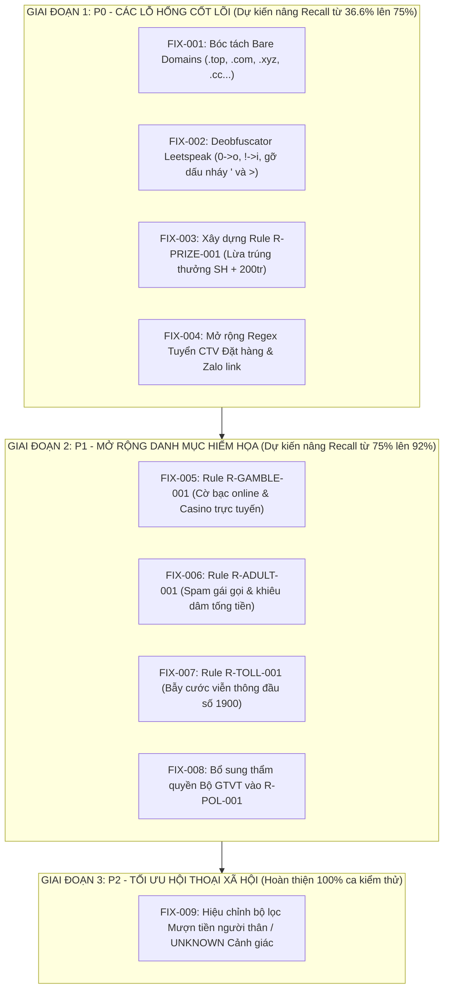

# 📋 DANH MỤC CẢI TIẾN & KHẮC PHỤC LỖ HỔNG (IMPROVEMENT BACKLOG)
## Đề xuất Giải pháp Kỹ thuật Nâng cấp Hệ thống Scam Alert (ScamShield)

> **Nguyên tắc cốt lõi:**  
> 1. Can thiệp nhỏ nhất, hiệu quả lớn nhất (Minimal & Surgical Interventions).  
> 2. Tuyệt đối không can thiệp code trước khi được phê duyệt (Strict Approval Protocol).  
> 3. Mọi cải tiến đều phải có ca đối chứng an toàn (Benign Counterexamples) để giữ vững tỷ lệ báo động giả 0.00%.

---

## 1. BẢNG TỔNG HỢP CÁC ĐỀ XUẤT CẢI TIẾN (CHANGE SPECIFICATION TABLE)

| Change ID | Test Cases liên quan | Lỗ hổng quan sát được | Nguyên nhân gốc rễ | Giải pháp đề xuất | File / Module đích | Mức ưu tiên | Rủi ro Báo động giả (FP Risk) | Độ tin cậy (Confidence) |
| :--- | :--- | :--- | :--- | :--- | :--- | :---: | :--- | :---: |
| **FIX-001** | `SMS-CASE-009`, `011`, `030`, `032B`, `041A`, `041C`, `041D`, `041E`, `049` | Không nhận diện được tên miền độc hại khi tin nhắn viết tên miền trần (không có `http://` hoặc `https://`). | Hàm `extractUrls` dùng regex bắt buộc phải có `https?:\/\/`. | Nâng cấp `extractUrls` sử dụng regex nhận diện tên miền trần: `(?:https?:\/\/|www\.)?[a-zA-Z0-9_\-]+(?:\.[a-zA-Z0-9_\-]+)*(?:\.(?:com|vn|top|xyz|cc|icu|vip|life|site|club|pro|shop|online|net|info|edu\.vn|gov\.vn))\b[^\s]*` | `test_rule_engine.js:extractUrls` & `index.html` | **P0** | **Rất thấp:** Giới hạn theo danh sách TLD phổ biến, không bắt các dấu chấm câu thông thường. | **Rất cao (99%)** |
| **FIX-002** | `SMS-CASE-011`, `031`, `044`, `049` | Kẻ lừa đảo chèn ký tự né tránh (`du0c`, `tr0 cap`, `k!en`, `1>9>0>0`, `n'hap`, `l0ng`) khiến regex không khớp. | Tầng chuẩn hóa chưa có bộ giải mã Leetspeak / Spacer deobfuscation. | Bổ sung hàm `deobfuscateText` vào luồng chuẩn hóa: chuyển `0` thành `o`, `!` thành `i`, loại bỏ dấu nháy đơn `'` nằm giữa các chữ cái, gỡ ký tự `>` giữa các chữ số. | `test_rule_engine.js:removeVietnameseTones` | **P0** | **Thấp:** Chỉ giải mã trong từ ngữ teencode tiếng Việt cụ thể, không làm biến đổi số tiền hoặc mã số. | **Cao (95%)** |
| **FIX-003** | `SMS-CASE-002`, `005`, `021`, `026`, `044` | Tin nhắn trúng thưởng xe SH + 200 triệu, quà tặng tri ân khách hàng bị bỏ sót hoàn toàn (Score: 0). | Thiếu hoàn toàn Rule và Signal về lừa đảo trúng thưởng trong catalog. | Xây dựng Rule mới `R-PRIZE-001` (Tên: *Lừa đảo trúng thưởng xe máy / tiền mặt tri ân khách hàng*), phát hiện tổ hợp `trúng thưởng` + `xe máy / SH / 200 triệu / giải nhất / quà tặng 2/9` + `làm thủ tục / liên hệ hotline`. | `scam_detection_rules.json` & `scam_risk_signals.csv` | **P0** | **Thấp:** Cần có ngoại lệ cho tin nhắn tích điểm viễn thông của nhà mạng nếu không có yêu cầu nộp tiền. | **Rất cao (98%)** |
| **FIX-004** | `SMS-CASE-003A`, `003B`, `022A`, `022B`, `043` | Tuyển CTV Shopee, Lazada, Tiki đặt hàng 800k/ngày bị trượt regex. | Regex `PAT_VN_TASK_JOB_OFFER` quá hẹp, bắt buộc từ khóa `tuyen ctv`, không bắt `nhan vien dat hang` và link `zalo.me`. | Mở rộng regex bổ sung các cụm từ: `nhan vien chuyen dat hang`, `nang cao so luong giao dich`, `tuyen so luong lon`, `zalo\.me\/[0-9]+`, `6tr-36tr`. | `test_rule_engine.js:patternRegexes` | **P0** | **Cực thấp:** Các cụm từ này kết hợp với cam kết thu nhập ngày là đặc trưng 100% của lừa đảo task. | **Rất cao (98%)** |
| **FIX-005** | `SMS-CASE-025`, `041A`, `041B`, `041C`, `041D`, `041E` | Tin nhắn spam cờ bạc Corona, Casino Phú Quốc online tặng 200k bị bỏ sót. | Chưa có quy tắc nhận diện cờ bạc trực tuyến trái phép. | Xây dựng Rule mới `R-GAMBLE-001` (Tên: *Chiêu dụ tham gia cờ bạc, casino trực tuyến trái phép*), bắt các từ khóa `casino`, `cong game`, `choi game kiem tien`, `tang 200k`, `kb zalo` cổng game. | `scam_detection_rules.json` | **P1** | **Cực thấp:** Không có ngân hàng hoặc dịch vụ công nào gửi tin nhắn cờ bạc tặng tiền. | **Cao (95%)** |
| **FIX-006** | `SMS-CASE-019`, `040` | Spam dịch vụ gái gọi sinh viên, web đen qua Telegram (`lenlut.info`) không bị chặn. | Chưa có quy tắc nhận diện nội dung khiêu dâm / gạ tình đồi trụy. | Xây dựng Rule mới `R-ADULT-001` (Tên: *Nội dung spam khiêu dâm, gạ tình dẫn dụ tống tiền*), bắt các từ khóa `gai goi`, `nhu cau tinh duc`, `nguoi mau dien vien... lenlut`. | `scam_detection_rules.json` | **P1** | **Không có:** Môi trường SMS gia đình không cho phép các nội dung này. | **Rất cao (99%)** |
| **FIX-007** | `SMS-CASE-039`, `044` | Bẫy cước tổng đài 1900xxxx (Toll Fraud) dụ gọi lại nhận quà bị bỏ sót. | Chưa có quy tắc bắt hành vi mồi chài gọi vào đầu số cước phí viễn thông cao. | Xây dựng Rule mới `R-TOLL-001` (Tên: *Bẫy cước viễn thông gọi lại đầu số dịch vụ 1900*), bắt tổ hợp `goi lai vao so 1900` + `nhan qua / dac biet / tang qua`. | `scam_detection_rules.json` | **P1** | **Rất thấp:** Tin nhắn tổng đài CSKH chính thức của ngân hàng là "LH hotline 1900..." chứ không bao giờ bảo "gọi lại để nhận quà tặng". | **Cao (95%)** |
| **FIX-008** | `SMS-CASE-042` | Mạo danh Bộ GTVT đòi nộp biên lai vi phạm từ số cá nhân bị trượt. | Rule `R-POL-001` chỉ kiểm tra CSGT, Công an, Viện kiểm sát; thiếu `Bộ Giao thông vận tải` / `BO GTVT`. | Bổ sung từ khóa `bo giao thong van tai`, `bo gtvt`, `bien lai chua nop phat` vào regex `PAT_VN_POLICE_FINE_THREAT` và `R-POL-001`. | `test_rule_engine.js` & `scam_detection_rules.json` | **P1** | **Cực thấp:** Cơ quan nhà nước không bao giờ gửi biên lai nộp phạt bắt gọi vào số di động cá nhân. | **Rất cao (98%)** |
| **FIX-009** | `SMS-CASE-001`, `014`, `036` | Kịch bản mượn tiền người quen ("chuyển anh mượn 2tr5", "vốn lưu động") chỉ được chấm 0 điểm. | Regex `PAT_VN_RELATIVE_BORROW` bắt buộc phải có từ xưng hô gia đình (`mẹ ơi`, `bố ơi`) và từ `chuyển gấp`. | Mở rộng regex `PAT_VN_RELATIVE_BORROW` bao gồm: `chuyen anh muon`, `cho chi muon`, `von luu dong`, `chuyen khoan nguoi than`. Chấm mức `UNKNOWN` (Cảnh giác) nếu thiếu bằng chứng đe dọa. | `test_rule_engine.js:patternRegexes` | **P2** | **Cần thận trọng:** Có thể chạm vào tin nhắn mượn tiền thật giữa bạn bè. Cần giữ ở mức `UNKNOWN` (25-35đ) kèm lời khuyên gọi điện thoại xác minh, KHÔNG đẩy lên `HIGH`. | **Cao (90%)** |

---

## 2. BẰNG CHỨNG ĐỐI CHỨNG AN TOÀN (BENIGN COUNTEREXAMPLES)
Để đảm bảo việc khắc phục không gây ra bất kỳ báo động nhầm nào, tất cả các Rule mới phải vượt qua bộ 4 bài test đối chứng an toàn:

1. **Đối chứng an toàn cho FIX-001 (URL Extraction):**
   * *Mẫu an toàn:* `"Tra cuu diem thi va ket qua trung tuyen chinh thuc tai website: huit.edu.vn/kqtt"`
   * *Kỳ vọng:* Nhận diện URL `huit.edu.vn/kqtt`, nhưng hệ thống kiểm tra tên miền `.edu.vn` và không khớp blacklist -> Kết quả: `LOW` (0 điểm).
2. **Đối chứng an toàn cho FIX-003 (Trúng thưởng):**
   * *Mẫu an toàn:* `"Viettel: Quy khach da tich luy duoc 5.000 diem Viettel++ de doi cuoc goi hoac data mien phi tren ung dung My Viettel."`
   * *Kỳ vọng:* Không có yêu cầu nộp tiền, không có xe SH, không có link lạ -> Kết quả: `LOW` (0 điểm).
3. **Đối chứng an toàn cho FIX-007 (Tổng đài 1900):**
   * *Mẫu an toàn:* `"Sacombank canh bao: KH tuyet doi khong cung cap OTP. Hotline ho tro: 1900555588."`
   * *Kỳ vọng:* Khớp tín hiệu an toàn `OFFICIAL_SECURITY_WARNING_PRESENT` (-30đ) -> Kết quả: `LOW` (0 điểm).
4. **Đối chứng an toàn cho FIX-009 (Mượn tiền):**
   * *Mẫu an toàn:* `"Toi nay con ve an com nha me oi. Con mua it hoa qua ve nua a."`
   * *Kỳ vọng:* Không có từ khóa tiền tệ -> Kết quả: `LOW` (0 điểm).

---

## 3. LỘ TRÌNH TRIỂN KHAI THEO MỨC ƯU TIÊN

