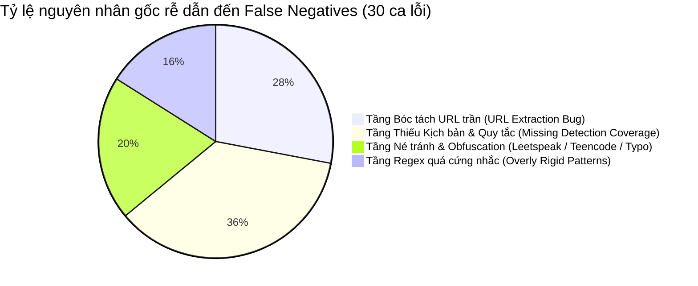

# 🔍 PHÂN TÍCH NGUYÊN NHÂN GỐC RỄ CÁC CA THẤT BẠI (ROOT CAUSE ANALYSIS)
## Dự án: Scam Message Detection Platform (ScamShield)
> **Dựa trên kết quả thử nghiệm Baseline:** 26 ca False Negative (Bỏ sót lừa đảo) và 4 ca Insufficient Detection (Cảnh báo chưa đủ lực) trong tổng số 49 ca thực nghiệm từ thư mục `sms example/`.

---

## 1. PHÂN BỐ CÁC TẦNG LỖI SỚM NHẤT TRONG PIPELINE (EARLIEST FAILING PIPELINE STAGES)



---

## 2. PHÂN TÍCH CHI TIẾT THEO 6 NHÓM NGUYÊN NHÂN CỐT LÕI

### Nhóm 1: Lỗi Bóc tách URL trần (URL Extraction Bug: Missing Bare Domains / Non-HTTP URLs)
* **Các ca ảnh hưởng:** `SMS-CASE-009`, `SMS-CASE-011`, `SMS-CASE-030`, `SMS-CASE-032B`, `SMS-CASE-041A`, `SMS-CASE-041C`, `SMS-CASE-041D`, `SMS-CASE-041E`, `SMS-CASE-049`.
* **Tầng thất bại sớm nhất:** `Tầng Tiền xử lý (Preprocessing & URL Extraction)`.
* **Bằng chứng kỹ thuật tại Source Code:**
  Trong [`test_rule_engine.js:L145-L149`](file:///d:/Me%20mine/PM/UXCamp/Scam%20alert/scam_alert_check_link_4/test_rule_engine.js#L145-L149):
  ```javascript
  function extractUrls(text) {
    const urlRegex = /(https?:\/\/[^\s]+)/gi;
    const matches = text.match(urlRegex) || [];
    return matches;
  }
  ```
* **Phân tích cơ chế lỗi:**
  * Kẻ lừa đảo trong thực tế luôn cố gắng tiết kiệm ký tự SMS (giới hạn 160 ký tự) nên thường xuyên viết tên miền trần (bare domain) không có `http://` hoặc `https://`, ví dụ: `dichvuconggov-vn.com`, `tinyurl.com/kxytdc8z`, `www.vcbigaobink.com`, `sacombank.vn-me.top`, `www.smartbiddv.com`.
  * Hàm `extractUrls` chỉ bắt được link bắt đầu bằng `http://` hoặc `https://`. Hệ quả là `context.urls` trả về mảng rỗng `[]`.
  * Khi `context.urls = []`, toàn bộ các nhánh AST điều kiện quan trọng như `CONTAINS_URL`, `IS_HOMOGLYPH_DOMAIN`, `URL_HAS_INDICATOR` đều lập tức trả về `false`, khiến rule `R-BNK-002`, `R-SUB-FEE` bị trượt hoàn toàn.

---

### Nhóm 2: Lỗ hổng Trắng về Kịch bản Lừa đảo Trúng thưởng & Tri ân (Complete Missing Coverage: Lottery & Prize Scams)
* **Các ca ảnh hưởng:** `SMS-CASE-002` (Messengër SH+200tr), `SMS-CASE-005` (BeeTalk Vòng quay may mắn `Http://giaithuong.us`), `SMS-CASE-021` (Zalo tri ân SH+200tr), `SMS-CASE-026` (Chính phủ tặng 100k 2/9 `1234.xyz`), `SMS-CASE-044` (Trúng thưởng iPhone 5s `1>9>0>0>1>9>9>5`).
* **Tầng thất bại sớm nhất:** `Tầng Tri thức & Quy tắc (Detection Coverage & Rule Catalog)`.
* **Bằng chứng kỹ thuật tại Source Code:**
  * Tra cứu toàn bộ tập rules [`scam_detection_rules.json`](file:///d:/Me%20mine/PM/UXCamp/Scam%20alert/scam_alert_check_link_4/scam_detection_rules.json): Hiện chỉ có các nhóm `CREDENTIAL_THEFT`, `BANK_IMPERSONATION`, `LEGAL_THREAT`, `JOB_SCAM`, `RECOVERY_SCAM`, `SOCIAL_ENGINEERING`.
  * **HOÀN TOÀN KHÔNG CÓ** bất kỳ quy tắc nào cho chủ đề `LOTTERY_PRIZE_SCAM` (Lừa đảo trúng thưởng, tặng quà tri ân khách hàng, vòng quay may mắn, trúng xe SH/xe máy/tiền mặt, quà tặng chính phủ).
  * Mặc dù chiêu trò này xuất hiện rất nhiều trong đời sống và chiếm tới 10% tập ảnh thực tế, hệ thống hiện tại chấm 0 điểm (Score 0, Risk `LOW`).

---

### Nhóm 3: Regex Tuyển CTV & Việc làm Online bị trượt trước các biến thể thực tế (Rigid Regex in Task/Job Scams)
* **Các ca ảnh hưởng:** `SMS-CASE-003A` (Shopee fake), `SMS-CASE-003B` (Lazada fake), `SMS-CASE-022A` (Tiki CTV 300k-1000k), `SMS-CASE-022B` (Tiki 800k/ngày), `SMS-CASE-043` (Tuyển việc làm 6tr-36tr).
* **Tầng thất bại sớm nhất:** `Tầng Biểu thức Chính quy (Pattern Regex Definition)`.
* **Bằng chứng kỹ thuật tại Source Code:**
  Trong [`test_rule_engine.js:L157`](file:///d:/Me%20mine/PM/UXCamp/Scam%20alert/scam_alert_check_link_4/test_rule_engine.js#L157):
  ```javascript
  'PAT_VN_TASK_JOB_OFFER': /(tuyen\s*ctv|tuyển\s*ctv|viec\s*nhe|việc\s*nhẹ|lam\s*nhiem\s*vu|làm\s*nhiệm\s*vụ|ctv\s*online|danh\s*gia\s*san\s*pham|đánh\s*giá\s*sản\s*phẩm|quy\s*dau\s*tu|quỹ\s*đầu\s*tư|dau\s*tu|đầu\s*tư|sinh\s*loi|sinh\s*lời).{0,120}(thu\s*nhap|thu\s*nhập|\d+k\/ngay|\d+k\/ngày|kiem\s*tien|kiếm\s*tiền|hoa\s*hong|hoa\s*hồng|nhan\s*tien|nhận\s*tiền|loi\s*nhuan|lợi\s*nhuận|bao\s*hiem\s*von|bảo\s*hiểm\s*vốn|500k\s*trai\s*nghiem)/i
  ```
* **Phân tích cơ chế lỗi:**
  * Regex bắt buộc cụm từ vế trái phải là `tuyen ctv`, `viec nhe`, `lam nhiem vu`, `danh gia san pham`.
  * Nhưng trong ảnh thực tế `SMS-CASE-003A` & `003B`, kẻ lừa đảo viết: *"mình là giám đốc marketing của Shopee/Lazada, hiện tại cửa hàng Shopee cần tuyển số lượng lớn nhân viên chuyên đặt hàng để nâng cao số lượng giao dịch... kiếm 800.000 đồng..."*.
  * Cụm từ *"tuyển số lượng lớn nhân viên chuyên đặt hàng"* hoặc *"muốn tìm công việc không? Với mức lương là 6tr-36tr"* KHÔNG KHỚP với danh sách từ khóa cố định trong vế 1 của regex, dẫn tới regex trả về `false`.
  * Ngoài ra, link liên kết lại là `zalo.me/...` hoặc số Zalo thuần túy chứ không phải domain web, khiến điều kiện phụ không được thỏa mãn.

---

### Nhóm 4: Bị qua mặt bởi Kỹ thuật Biến tướng Ký tự & Teencode (Obfuscation, Leetspeak & Spacers)
* **Các ca ảnh hưởng:** `SMS-CASE-011` (`du0c tr0 cap... kh0ng`), `SMS-CASE-031` (`th0a dieu k!en nahn t!en`), `SMS-CASE-044` (`1>9>0>0>1>9>9>5`), `SMS-CASE-049` (`n'hap... l0ng... mat k'hau... smartbiddv.com`).
* **Tầng thất bại sớm nhất:** `Tầng Chuẩn hóa Văn bản (Text Normalization & Deobfuscation)`.
* **Bằng chứng kỹ thuật tại Source Code:**
  Trong [`test_rule_engine.js:L105-L142`](file:///d:/Me%20mine/PM/UXCamp/Scam%20alert/scam_alert_check_link_4/test_rule_engine.js#L105-L142):
  * Hàm `removeVietnameseTones` hiện tại xử lý xuất sắc Unicode NFKD và Cyrillic Homoglyphs (ví dụ `а` sang `a`, `о` sang `o`).
  * **NHƯNG:** Hệ thống chưa có bộ giải mã Leetspeak / Teencode:
    * Thay `o` bằng số `0` (`kh0ng`, `tr0 cap`, `th0a`).
    * Thay `i` bằng dấu chấm than `!` (`k!en`, `t!en`).
    * Chèn dấu nháy đơn giữa từ (`n'hap`, `k'hau`).
    * Chèn dấu ngăn cách giữa số tổng đài cước cao (`1>9>0>0>1>9>9>5`).
  * Kết quả: Text sau khi chuẩn hóa vẫn giữ nguyên các ký tự dị biệt này, khiến các biểu thức chính quy tiếng Việt thông thường bị phá vỡ hoàn toàn.

---

### Nhóm 5: Thiếu Bộ Quy tắc về Cờ bạc Trực tuyến & Spam Đồi trụy / Gạ tình (Online Gambling & Adult / Escort Pretexts)
* **Các ca ảnh hưởng:** `SMS-CASE-019` (Spam mại dâm sinh viên `t.me/okGuO`), `SMS-CASE-025` (Cổng game tri ân CSKH VIP), `SMS-CASE-040` (Gái gọi người mẫu `lenlut.info`), `SMS-CASE-041A, B, C, D, E` (Corona casino tặng 200k `470407.com`, `470412.com`, `470420.com`).
* **Tầng thất bại sớm nhất:** `Tầng Tri thức & Danh mục Nguy cơ (Threat Intelligence & Risk Signal Catalog)`.
* **Phân tích cơ chế lỗi:**
  * Đây là một mảng lớn trong tin nhắn rác / tin nhắn lừa đảo viễn thông tại Việt Nam: các đường dây cờ bạc lậu (Campuchia/Philippines) và web đen dùng SMS để lôi kéo người dùng vào bẫy cá cược hoặc tống tiền bằng video nhạy cảm (sextortion).
  * Do engine ban đầu chỉ tập trung vào lừa đảo tài chính ngân hàng và dịch vụ công, nên các từ khóa `casino`, `cong game`, `danh bai`, `gai goi`, `nhu cau tinh duc`, `lenlut` chưa có rule riêng nào xử lý.

---

### Nhóm 6: Hạn chế trong Nhận diện Bẫy cước Viễn thông 1900 & Đe dọa Tống tiền Tâm lý
* **Các ca ảnh hưởng:**
  * `SMS-CASE-039` & `SMS-CASE-044`: Bẫy cước tổng đài 1900 (Toll Fraud: lừa gọi lại vào đầu số 1900xxxx để bị trừ 15.000đ - 30.000đ/phút).
  * `SMS-CASE-042`: Mạo danh Bộ GTVT gửi biên lai vi phạm cuối cùng, bắt liên hệ số di động cá nhân `0782320830` (Rule `R-POL-001` chỉ kiểm tra Cảnh sát giao thông, chưa bao gồm Bộ Giao thông Vận tải).
  * `SMS-CASE-046`: Tin nhắn tống tiền đe dọa xét nghiệm ADN (chưa có quy tắc phát hiện đe dọa tống tiền đời tư / extortion).

---

## 3. BẢNG TỔNG HỢP NGUYÊN NHÂN GỐC RỄ CHO TOÀN BỘ 40 CA THẤT BẠI

| Nhóm lỗi | Số ca | Test Case IDs | Tầng lỗi sớm nhất | Giải pháp kỹ thuật cần thiết |
| :--- | :---: | :--- | :--- | :--- |
| **G1: Lỗi bóc tách URL trần (Bare Domains)** | 9 | `009`, `011`, `030`, `032B`, `041A`, `041C`, `041D`, `041E`, `049` | URL Extraction | Nâng cấp Regex trích xuất URL hỗ trợ bắt cả bare domains (`www.*`, `*.top`, `*.com`, `*.vn`, `*.icu`, `*.xyz`, `*.cc`, `*.info`) không cần `http://`. |
| **G2: Thiếu quy tắc Trúng thưởng / Tri ân** | 5 | `002`, `005`, `021`, `026`, `044` | Rule Catalog | Xây dựng Rule mới `R-PRIZE-001` (Phát hiện lừa đảo trúng thưởng, tri ân xe SH, tiền mặt, tặng quà ngày lễ). |
| **G3: Regex Tuyển CTV / Việc làm quá cứng** | 5 | `003A`, `003B`, `022A`, `022B`, `043` | Pattern Regex | Mở rộng regex `PAT_VN_TASK_JOB_OFFER` hỗ trợ cụm từ *"tuyển nhân viên đặt hàng"*, *"giám đốc marketing"*, *"việc làm 6tr-36tr"*, hỗ trợ nhận diện link `zalo.me`. |
| **G4: Né tránh bằng Teencode / Leetspeak** | 4 | `011`, `031`, `044`, `049` | Normalization | Bổ sung tầng giải mã Deobfuscation (`0`->`o`, `!`->`i`, xóa ký tự chèn `'>'`, `'`'`) trước khi chạy regex. |
| **G5: Thiếu quy tắc Cờ bạc online & Web đen** | 7 | `019`, `025`, `040`, `041A`, `041B`, `041C`, `041D` | Rule Catalog | Xây dựng Rule mới `R-GAMBLE-001` (Cờ bạc online) và `R-ADULT-001` (Spam khiêu dâm / gạ tình). |
| **G6: Bẫy cước 1900 & Thiếu thẩm quyền Bộ GTVT** | 5 | `001`, `014`, `036`, `039`, `042` | Rule Catalog & Logic | Xây dựng Rule `R-TOLL-001` (Bẫy cước 1900), bổ sung Bộ GTVT vào `R-POL-001`, nới rộng bẫy vay mượn người thân `R-REL-001`. |
